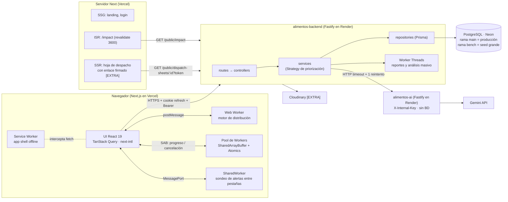
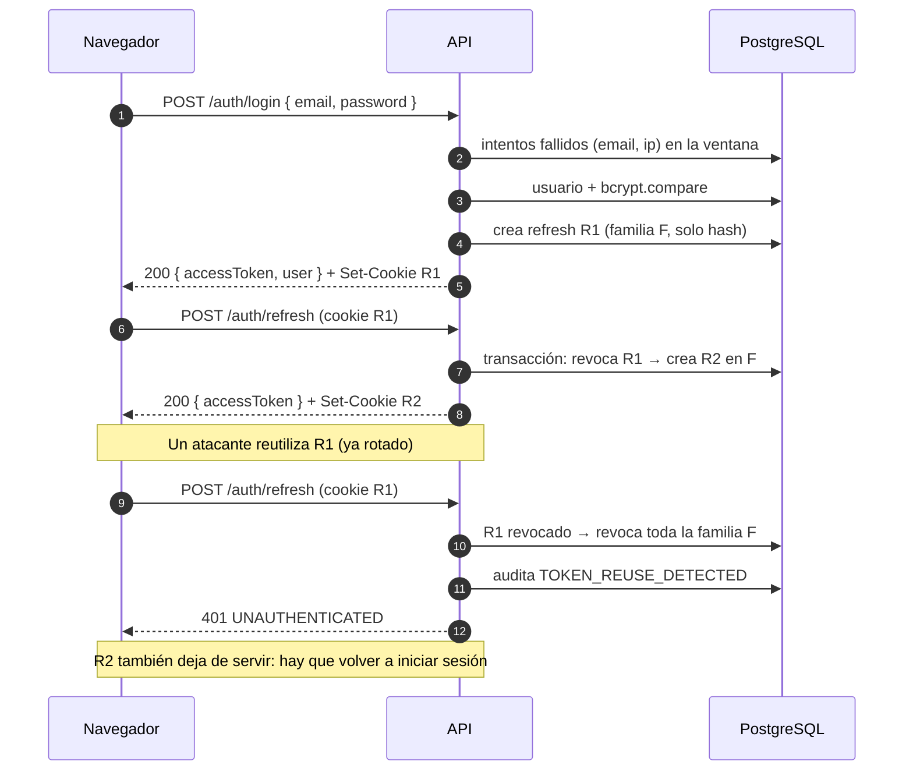

# alimentos-backend

API REST de **AlimentaIQ — Centro Inteligente de Distribución de Alimentos**. Gestiona productos,
inventario por lotes (FEFO), clientes, pedidos, propuestas de distribución, alertas, reportes y
métricas, y actúa como proxy hacia el servicio de IA (`alimentos-ai`).

- Stack: Node 22 LTS · Fastify 5 · TypeScript estricto · Zod · Prisma 5 · PostgreSQL (Neon).
- Despliegue: Render (API) · Neon (base de datos).
- Contrato completo: [docs/api-contract.md](docs/api-contract.md). No hay código compartido con
  `alimentos-frontend` ni con `alimentos-ai`.

## Arquitectura



Capas del backend: `route → controller → service → repository (Prisma)`.

## Endpoints disponibles

| Método | Ruta                   | Respuesta                                                               |
| ------ | ---------------------- | ----------------------------------------------------------------------- |
| GET    | `/health`              | `{ status: "ok", service, version, uptimeSec }` (sin BD; Render)        |
| GET    | `/api/v1/health`       | Igual que `/health`                                                     |
| GET    | `/api/v1/health/ready` | `{ status: "ok", db: "up" }` o 503 `{ status: "degraded", db: "down" }` |
| POST   | `/api/v1/auth/login`   | `{ accessToken, user }` + cookie `refresh_token`                        |
| POST   | `/api/v1/auth/refresh` | `{ accessToken }` + cookie rotada                                       |
| POST   | `/api/v1/auth/logout`  | 204 y cookie borrada                                                    |
| GET    | `/api/v1/auth/me`      | `{ data: { id, email, name, role } }` (Bearer)                          |
| GET    | `/api/v1/audit-logs`   | Lista paginada; solo `ADMIN`; filtros `action`, `userId`, `from`, `to`  |

Todas las respuestas incluyen `Server-Timing: app;dur=<ms>`. Los errores siguen el formato
`{ "error": { "code", "message", "details" } }`.

## Requisitos

- Node 22 LTS (ver `.nvmrc`) y npm.
- Una base de datos PostgreSQL (rama `dev` de Neon para desarrollo).

## Puesta en marcha local

```bash
npm ci
cp .env.example .env   # y completa los valores
npx prisma generate
npx prisma migrate dev
npx prisma db seed     # crea o actualiza el ADMIN y el OPERATOR demo
npm run dev
curl -i http://localhost:4000/health
```

## Variables de entorno

Plantilla en [.env.example](.env.example). Nunca se commitean valores reales.

| Variable                 | Obligatoria | Uso                                                      |
| ------------------------ | ----------- | -------------------------------------------------------- |
| `NODE_ENV`               | Sí          | `development` · `test` · `production`                    |
| `PORT`                   | No          | Render lo inyecta; en local 4000 por defecto             |
| `DATABASE_URL`           | Sí          | Conexión pooled de Neon (la usa la app)                  |
| `DIRECT_URL`             | Sí          | Conexión directa de Neon (la usan las migraciones)       |
| `CORS_ORIGINS`           | Sí          | Orígenes permitidos separados por comas                  |
| `JWT_ACCESS_SECRET`      | Sí          | Firma del access token (mínimo 32 caracteres)            |
| `ACCESS_TOKEN_TTL`       | No          | Duración del access token (`15m` por defecto)            |
| `REFRESH_TOKEN_TTL_DAYS` | No          | Días de vida del refresh token (7 por defecto)           |
| `LOGIN_MAX_ATTEMPTS`     | No          | Intentos fallidos por email + IP (5 por defecto)         |
| `LOGIN_WINDOW_MINUTES`   | No          | Ventana del límite de intentos (15 por defecto)          |
| `SHEET_LINK_SECRET`      | [EXTRA]     | Enlaces firmados de hoja de despacho                     |
| `AI_SERVICE_URL`         | Fase IA     | URL de `alimentos-ai`                                    |
| `AI_INTERNAL_KEY`        | Fase IA     | Clave enviada en `X-Internal-Key`                        |
| `AI_TIMEOUT_MS`          | Fase IA     | Timeout de las llamadas a la IA                          |
| `CLOUDINARY_URL`         | [EXTRA]     | Fotos de productos                                       |
| `SEED_ADMIN_EMAIL`       | Seed        | Email del admin demo (sin valor por defecto)             |
| `SEED_ADMIN_PASSWORD`    | Seed        | 12+ caracteres con mayúscula, minúscula, número, símbolo |
| `SEED_OPERATOR_EMAIL`    | Seed        | Email del operador demo (sin valor por defecto)          |
| `SEED_OPERATOR_PASSWORD` | Seed        | Contraseña del operador demo (sin valor por defecto)     |
| `SEED_SIZE`              | Seed        | `small` · `large` (`large` solo en local o rama `bench`) |

Si falta una variable obligatoria el servidor no arranca e indica cuál falta (sin mostrar valores).
Las `SEED_*` solo las valida el script de seed.

## Scripts

| Script                 | Descripción                          |
| ---------------------- | ------------------------------------ |
| `npm run dev`          | Servidor en modo watch (`tsx watch`) |
| `npm run build`        | Compila TypeScript a `dist/`         |
| `npm start`            | Ejecuta `dist/server.js`             |
| `npm test`             | Pruebas con Vitest (no requieren BD) |
| `npm run lint`         | ESLint con reglas type-aware         |
| `npm run typecheck`    | `tsc --noEmit`                       |
| `npm run format`       | Formatea con Prettier                |
| `npm run format:check` | Verifica el formato (lo usa CI)      |

## Puertos

| Servicio             | Puerto local |
| -------------------- | ------------ |
| `alimentos-frontend` | 3000         |
| `alimentos-backend`  | 4000         |
| `alimentos-ai`       | 4100         |

## Migraciones

- Las migraciones se crean **solo** con `npx prisma migrate dev --name <nombre>` contra la rama
  `dev` de Neon (la que apunta tu `.env` local).
- Son **solo aditivas**: no se editan migraciones ya commiteadas ni se borran columnas o tablas en uso.
- Se aplican a producción **manualmente, desde local y antes de desplegar**:

```bash
DATABASE_URL=<main> DIRECT_URL=<main> npx prisma migrate deploy
```

donde `<main>` son las cadenas de conexión de la rama `main` de Neon (nunca se commitean).
Render no ejecuta migraciones.

## Despliegue en Render

| Ajuste        | Valor                                                          |
| ------------- | -------------------------------------------------------------- |
| Build Command | `npm ci --include=dev && npx prisma generate && npm run build` |
| Start Command | `npm start`                                                    |
| Health Check  | `/health`                                                      |
| `PORT`        | No se define: Render lo inyecta                                |

Las variables de entorno se configuran en el panel de Render.

## Autenticación

El frontend vive en `*.vercel.app` y la API en `*.onrender.com` (sitios distintos, sin dominio
propio). CORS usa una allowlist (`CORS_ORIGINS`) con `credentials: true`.

- **Access token**: JWT `{ sub, role }` firmado con `JWT_ACCESS_SECRET`, vida `ACCESS_TOKEN_TTL`.
  Va en `Authorization: Bearer`.
- **Refresh token**: opaco (48 bytes aleatorios en base64url). En la BD solo se guarda su hash
  SHA-256. Viaja **solo** en la cookie `refresh_token` (`HttpOnly; Secure; SameSite=None;
Path=/api/v1/auth; Max-Age = REFRESH_TOKEN_TTL_DAYS`), nunca en el body.
- **Rotación**: cada `/auth/refresh` revoca el token actual y crea uno nuevo en la misma familia,
  en una sola transacción. Si llega un token ya rotado (robado o reutilizado) se revoca **toda la
  familia** y se audita `TOKEN_REUSE_DETECTED`.
- **Contraseñas**: bcrypt con cost 12. Si el email no existe se compara igual contra un hash
  ficticio, para que el tiempo de respuesta no revele qué cuentas existen.
- **Errores uniformes**: email inexistente, contraseña incorrecta o usuario inactivo responden el
  mismo `401 INVALID_CREDENTIALS`.
- **Límite de intentos**: al llegar a `LOGIN_MAX_ATTEMPTS` fallos para el mismo email + IP dentro
  de `LOGIN_WINDOW_MINUTES`, el login responde `429 TOO_MANY_REQUESTS` con `Retry-After` y se
  audita `LOGIN_BLOCKED`. Un login correcto reinicia el contador. `trustProxy` está activo para que
  `request.ip` sea la IP real detrás del proxy de Render.
- **Autorización**: `app.authenticate` valida el Bearer (`401 TOKEN_EXPIRED` si expiró,
  `401 UNAUTHENTICATED` si es inválido) y `app.authorize('ADMIN')` responde `403 FORBIDDEN`. Los
  roles siempre se validan en el servidor.
- **Auditoría**: `AuditService.record(...)` guarda `LOGIN_SUCCESS`, `LOGIN_BLOCKED`,
  `TOKEN_REUSE_DETECTED` y `LOGOUT`. Nunca guarda contraseñas ni tokens en `metadata`.



### Usuarios demo (seed)

`npx prisma db seed` crea o actualiza (upsert por email) un `ADMIN` y un `OPERATOR` a partir de
`SEED_ADMIN_EMAIL`, `SEED_ADMIN_PASSWORD`, `SEED_OPERATOR_EMAIL` y `SEED_OPERATOR_PASSWORD`. No hay
valores por defecto: si falta alguna variable o la contraseña del admin es débil, falla con un
mensaje que nombra la variable sin mostrar su valor. Es idempotente y nunca imprime contraseñas.

## CI

GitHub Actions en cada push y PR a `main`: `npm ci`, `npx prisma generate`, lint, formato,
typecheck, pruebas y build. Las pruebas no necesitan base de datos.
