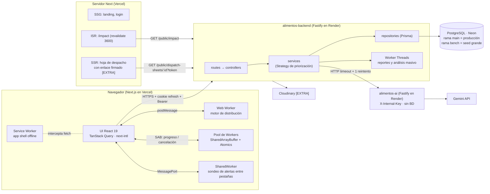
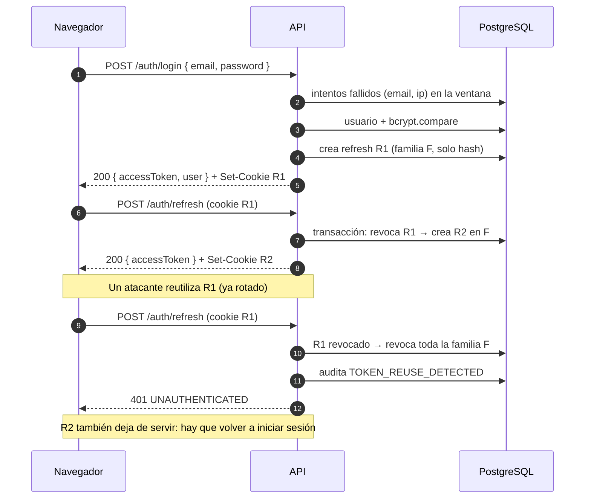

# alimentos-backend

API REST de **AlimentaIQ — Centro Inteligente de Distribución de Alimentos**. Gestiona productos,
inventario por lotes (FEFO), clientes, pedidos, propuestas de distribución, alertas, reportes y
métricas, y actúa como proxy hacia el servicio de IA (`alimentos-ai`).

- Stack: Node 22 LTS · Fastify 5 · TypeScript estricto · Zod · Prisma 5 · PostgreSQL (Neon).
- Despliegue: Render (API) · Neon (base de datos).
- Contrato completo: [docs/api-contract.md](docs/api-contract.md). No hay código compartido con
  `alimentos-frontend` ni con `alimentos-ai`.

## Arquitectura



Capas del backend: `route → controller → service → repository (Prisma)`.

## Endpoints disponibles

| Método | Ruta                                         | Respuesta                                                                                                |
| ------ | -------------------------------------------- | -------------------------------------------------------------------------------------------------------- |
| GET    | `/health`                                    | `{ status: "ok", service, version, uptimeSec }` (sin BD; Render)                                         |
| GET    | `/api/v1/health`                             | Igual que `/health`                                                                                      |
| GET    | `/api/v1/health/ready`                       | `{ status: "ok", db: "up" }` o 503 `{ status: "degraded", db: "down" }`                                  |
| POST   | `/api/v1/auth/login`                         | `{ accessToken, user }` + cookie `refresh_token`                                                         |
| POST   | `/api/v1/auth/refresh`                       | `{ accessToken }` + cookie rotada                                                                        |
| POST   | `/api/v1/auth/logout`                        | 204 y cookie borrada                                                                                     |
| GET    | `/api/v1/auth/me`                            | `{ data: { id, email, name, role } }` (Bearer)                                                           |
| GET    | `/api/v1/audit-logs`                         | Lista paginada; solo `ADMIN`; filtros `action`, `userId`, `from`, `to`                                   |
| GET    | `/api/v1/products`                           | Lista paginada con métricas; filtros `search`, `category`, `status`, `stockStatus`, `expiringWithinDays` |
| GET    | `/api/v1/products/:id`                       | `{ data }` con métricas y `lots[]` en orden FEFO                                                         |
| POST   | `/api/v1/products`                           | Solo `ADMIN`; 201; nombre repetido → 409 `DUPLICATE`                                                     |
| PATCH  | `/api/v1/products/:id`                       | Solo `ADMIN`; campos editables y `status` (no hay borrado físico)                                        |
| GET    | `/api/v1/inventory/lots`                     | Lotes con stock; filtros `productId`, `expiringWithinDays`, `includeExpired`                             |
| POST   | `/api/v1/inventory/entries`                  | Solo `ADMIN`; lote + movimiento `ENTRY` + auditoría (una transacción)                                    |
| POST   | `/api/v1/inventory/exits`                    | Solo `ADMIN`; `EXIT_WASTE` o `ADJUSTMENT`, con `lotId` o FEFO; 409 si no alcanza                         |
| GET    | `/api/v1/inventory/movements`                | Solo `ADMIN`; filtros `productId`, `type`, `from`, `to`                                                  |
| GET    | `/api/v1/inventory/summary`                  | `{ data: { totalProducts, lowStock, outOfStock, expiringSoon, wasteRiskHigh } }`                         |
| GET    | `/api/v1/customers`                          | Solo `ADMIN`; lista paginada; filtros `search`, `type`, `status`                                         |
| GET    | `/api/v1/customers/:id`                      | Solo `ADMIN`; `{ data }`                                                                                 |
| POST   | `/api/v1/customers`                          | Solo `ADMIN`; 201                                                                                        |
| PATCH  | `/api/v1/customers/:id`                      | Solo `ADMIN`; incluye `status` (no hay borrado físico)                                                   |
| GET    | `/api/v1/orders`                             | Lista paginada; filtros `status` (varios), `priority`, `customerId`, `dueBefore`                         |
| GET    | `/api/v1/orders/:id`                         | `{ data }` con `items[]`, cliente e `history[]`                                                          |
| POST   | `/api/v1/orders`                             | Solo `ADMIN`; 201; pedido + ítems + historial + auditoría en una transacción; no reserva stock           |
| PATCH  | `/api/v1/orders/:id/status`                  | Máquina de estados; cancelar solo `ADMIN` (con `RETURN` a los lotes); 409 si no aplica                   |
| GET    | `/api/v1/alerts`                             | `{ data: Alert[] }` calculadas al vuelo, de la más grave a la menos grave                                |
| GET    | `/api/v1/distribution/snapshot`              | Pedidos `PENDING`, lotes despachables, salida 30 días, pesos y reglas (para el Web Worker)               |
| POST   | `/api/v1/distribution/proposals`             | `{ strategy, weights? }` → el servidor calcula y guarda la propuesta `DRAFT`                             |
| GET    | `/api/v1/distribution/proposals[/:id]`       | Listado paginado; detalle con líneas agrupadas por pedido                                                |
| POST   | `/api/v1/distribution/proposals/:id/confirm` | Una transacción: descuenta FEFO, `EXIT_DISPATCH`, pedidos a `IN_PREPARATION`; 409 `STALE_PROPOSAL`       |
| POST   | `/api/v1/distribution/proposals/:id/discard` | Solo `DRAFT`                                                                                             |

Todas las respuestas incluyen `Server-Timing: app;dur=<ms>`. Los errores siguen el formato
`{ "error": { "code", "message", "details" } }`.

## Requisitos

- Node 22 LTS (ver `.nvmrc`) y npm.
- Una base de datos PostgreSQL (rama `dev` de Neon para desarrollo).

## Puesta en marcha local

```bash
npm ci
cp .env.example .env   # y completa los valores
npx prisma generate
npx prisma migrate dev
npx prisma db seed     # crea o actualiza el ADMIN y el OPERATOR demo
npm run dev
curl -i http://localhost:4000/health
```

## Variables de entorno

Plantilla en [.env.example](.env.example). Nunca se commitean valores reales.

| Variable                 | Obligatoria | Uso                                                      |
| ------------------------ | ----------- | -------------------------------------------------------- |
| `NODE_ENV`               | Sí          | `development` · `test` · `production`                    |
| `PORT`                   | No          | Render lo inyecta; en local 4000 por defecto             |
| `DATABASE_URL`           | Sí          | Conexión pooled de Neon (la usa la app)                  |
| `DIRECT_URL`             | Sí          | Conexión directa de Neon (la usan las migraciones)       |
| `CORS_ORIGINS`           | Sí          | Orígenes permitidos separados por comas                  |
| `JWT_ACCESS_SECRET`      | Sí          | Firma del access token (mínimo 32 caracteres)            |
| `ACCESS_TOKEN_TTL`       | No          | Duración del access token (`15m` por defecto)            |
| `REFRESH_TOKEN_TTL_DAYS` | No          | Días de vida del refresh token (7 por defecto)           |
| `LOGIN_MAX_ATTEMPTS`     | No          | Intentos fallidos por email + IP (5 por defecto)         |
| `LOGIN_WINDOW_MINUTES`   | No          | Ventana del límite de intentos (15 por defecto)          |
| `APP_TIMEZONE`           | No          | Zona del calendario de negocio (`America/Bogota`)        |
| `SHEET_LINK_SECRET`      | [EXTRA]     | Enlaces firmados de hoja de despacho                     |
| `AI_SERVICE_URL`         | Fase IA     | URL de `alimentos-ai`                                    |
| `AI_INTERNAL_KEY`        | Fase IA     | Clave enviada en `X-Internal-Key`                        |
| `AI_TIMEOUT_MS`          | Fase IA     | Timeout de las llamadas a la IA                          |
| `CLOUDINARY_URL`         | [EXTRA]     | Fotos de productos                                       |
| `SEED_ADMIN_EMAIL`       | Seed        | Email del admin demo (sin valor por defecto)             |
| `SEED_ADMIN_PASSWORD`    | Seed        | 12+ caracteres con mayúscula, minúscula, número, símbolo |
| `SEED_OPERATOR_EMAIL`    | Seed        | Email del operador demo (sin valor por defecto)          |
| `SEED_OPERATOR_PASSWORD` | Seed        | Contraseña del operador demo (sin valor por defecto)     |
| `SEED_SIZE`              | Seed        | `small` · `large` (`large` solo en local o rama `bench`) |

Si falta una variable obligatoria el servidor no arranca e indica cuál falta (sin mostrar valores).
Las `SEED_*` solo las valida el script de seed.

## Scripts

| Script                 | Descripción                          |
| ---------------------- | ------------------------------------ |
| `npm run dev`          | Servidor en modo watch (`tsx watch`) |
| `npm run build`        | Compila TypeScript a `dist/`         |
| `npm start`            | Ejecuta `dist/server.js`             |
| `npm test`             | Pruebas con Vitest (no requieren BD) |
| `npm run lint`         | ESLint con reglas type-aware         |
| `npm run typecheck`    | `tsc --noEmit`                       |
| `npm run format`       | Formatea con Prettier                |
| `npm run format:check` | Verifica el formato (lo usa CI)      |

## Puertos

| Servicio             | Puerto local |
| -------------------- | ------------ |
| `alimentos-frontend` | 3000         |
| `alimentos-backend`  | 4000         |
| `alimentos-ai`       | 4100         |

## Migraciones

- Las migraciones se crean **solo** con `npx prisma migrate dev --name <nombre>` contra la rama
  `dev` de Neon (la que apunta tu `.env` local).
- Son **solo aditivas**: no se editan migraciones ya commiteadas ni se borran columnas o tablas en uso.
- Se aplican a producción **manualmente, desde local y antes de desplegar**:

```bash
DATABASE_URL=<main> DIRECT_URL=<main> npx prisma migrate deploy
```

donde `<main>` son las cadenas de conexión de la rama `main` de Neon (nunca se commitean).
Render no ejecuta migraciones.

## Despliegue en Render

| Ajuste        | Valor                                                          |
| ------------- | -------------------------------------------------------------- |
| Build Command | `npm ci --include=dev && npx prisma generate && npm run build` |
| Start Command | `npm start`                                                    |
| Health Check  | `/health`                                                      |
| `PORT`        | No se define: Render lo inyecta                                |

Las variables de entorno se configuran en el panel de Render.

## Autenticación

El frontend vive en `*.vercel.app` y la API en `*.onrender.com` (sitios distintos, sin dominio
propio). CORS usa una allowlist (`CORS_ORIGINS`) con `credentials: true`.

- **Access token**: JWT `{ sub, role }` firmado con `JWT_ACCESS_SECRET`, vida `ACCESS_TOKEN_TTL`.
  Va en `Authorization: Bearer`.
- **Refresh token**: opaco (48 bytes aleatorios en base64url). En la BD solo se guarda su hash
  SHA-256. Viaja **solo** en la cookie `refresh_token` (`HttpOnly; Secure; SameSite=None;
Path=/api/v1/auth; Max-Age = REFRESH_TOKEN_TTL_DAYS`), nunca en el body.
- **Rotación**: cada `/auth/refresh` revoca el token actual y crea uno nuevo en la misma familia,
  en una sola transacción. Si llega un token ya rotado (robado o reutilizado) se revoca **toda la
  familia** y se audita `TOKEN_REUSE_DETECTED`.
- **Contraseñas**: bcrypt con cost 12. Si el email no existe se compara igual contra un hash
  ficticio, para que el tiempo de respuesta no revele qué cuentas existen.
- **Errores uniformes**: email inexistente, contraseña incorrecta o usuario inactivo responden el
  mismo `401 INVALID_CREDENTIALS`.
- **Límite de intentos**: al llegar a `LOGIN_MAX_ATTEMPTS` fallos para el mismo email + IP dentro
  de `LOGIN_WINDOW_MINUTES`, el login responde `429 TOO_MANY_REQUESTS` con `Retry-After` y se
  audita `LOGIN_BLOCKED`. Un login correcto reinicia el contador. `trustProxy` está activo para que
  `request.ip` sea la IP real detrás del proxy de Render.
- **Autorización**: `app.authenticate` valida el Bearer (`401 TOKEN_EXPIRED` si expiró,
  `401 UNAUTHENTICATED` si es inválido) y `app.authorize('ADMIN')` responde `403 FORBIDDEN`. Los
  roles siempre se validan en el servidor.
- **Auditoría**: `AuditService.record(...)` guarda `LOGIN_SUCCESS`, `LOGIN_BLOCKED`,
  `TOKEN_REUSE_DETECTED` y `LOGOUT`. Nunca guarda contraseñas ni tokens en `metadata`.



### Usuarios demo (seed)

`npx prisma db seed` crea o actualiza (upsert por email) un `ADMIN` y un `OPERATOR` a partir de
`SEED_ADMIN_EMAIL`, `SEED_ADMIN_PASSWORD`, `SEED_OPERATOR_EMAIL` y `SEED_OPERATOR_PASSWORD`. No hay
valores por defecto: si falta alguna variable o la contraseña del admin es débil, falla con un
mensaje que nombra la variable sin mostrar su valor. Es idempotente y nunca imprime contraseñas.

### Catálogo e inventario demo (seed)

Después de los usuarios, el seed carga **56 productos** de una distribuidora colombiana: arroz,
fríjol, leche, queso campesino, huevos, pollo, papa pastusa, plátano, tomate, pan, atún, gaseosa,
etc. Cada uno tiene categoría, unidad y stock mínimo coherentes.

- **Solo si la tabla `products` está vacía**, crea en una transacción:
  - 1 a 3 lotes con stock por producto;
  - un historial de recepciones y despachos (`EXIT_DISPATCH`) de los últimos 29 días con rotación
    variada.
    Todas las fechas son relativas a "hoy" en `APP_TIMEZONE`, así que la demo siempre muestra stock
    bajo, productos agotados, vencimientos próximos, lotes vencidos y riesgo de desperdicio.
- Si ya hay productos, solo agrega los del catálogo que falten y no toca el inventario. Correrlo
  dos veces no duplica nada.
- Las cantidades salen de un generador pseudoaleatorio con semilla fija: son reproducibles.
- Los movimientos demo quedan a nombre del admin del seed.
- `SEED_SIZE=large` (seed grande) llega en una fase posterior.

### Clientes y pedidos demo (seed)

- **15 clientes ficticios de Bogotá** de todos los tipos (supermercados, restaurantes, colegios,
  hospitales y dos bancos de alimentos); uno está `INACTIVE`. Solo si la tabla `customers` está vacía.
  Los emails usan el dominio reservado `example.com`.
- **Solo si la tabla `orders` está vacía**, crea en una transacción 35 pedidos `PENDING` y 2
  `CANCELLED` (sin movimientos), con 1 a 5 ítems e historial. Las fechas de entrega son relativas a
  hoy: 3 vencidos, 8 para hoy o mañana y el resto a 3–14 días.
- Los productos con stock bajo o agotados se piden por encima de lo disponible (`SHORTAGE_RISK` en
  al menos 3 productos) y los próximos a vencer también aparecen en pedidos.
- Correrlo otra vez no duplica ni cambia nada.

## Inventario

Cada producto tiene **lotes** (`InventoryLot`) con su fecha de vencimiento, y cada cambio de stock
queda como un **movimiento** (`InventoryMovement`) con su tipo, cantidad positiva, usuario y
motivo. Ningún producto se borra: se desactiva.

### Lógica pura y probada

`src/modules/inventory/domain/` no importa Prisma ni lee el reloj: recibe datos y devuelve
resultados.

- `allocateFefo(lots, qty, { today, includeExpired })` reparte una salida empezando por el lote que
  vence primero (desempate por recepción y luego por id) y devuelve las asignaciones y el
  faltante.
- `productMetrics({ minStock, lots }, salidas30d, today)` calcula `availableQty`, `nearestExpiry`,
  `stockStatus`, `avgDailyOut30d`, `coverageDays`, `wasteRisk` y `reasons[]` (códigos y
  parámetros, nunca texto). Los umbrales están en `INVENTORY_RULES` (`EXPIRY_WARNING_DAYS = 7`), y
  las alertas los reutilizarán.
- **Calendario**: "hoy" y los días hasta el vencimiento se calculan en `APP_TIMEZONE`
  (`America/Bogota`). A las 23:30 de Bogotá ya es el día siguiente en UTC, pero el sistema sigue
  usando la fecha de Bogotá. Un lote vence al terminar su `expiryDate`.
- **Cantidades**: `Decimal(12,3)` en la BD y `number` en el JSON. Las operaciones se hacen en
  milésimas enteras para evitar errores como `0.1 + 0.2 ≠ 0.3`.

### Salidas sin carreras

Una salida (`POST /inventory/exits`) se escribe en una transacción. Cada lote se descuenta con
`updateMany({ where: { id, quantity: { gte: qty } } })` y se verifica que actualizó una fila. Si
otra salida simultánea consumió el stock, PostgreSQL vuelve a evaluar la condición al liberar la
fila, la actualización afecta 0 filas y se hace rollback de todo. La respuesta es 409
`INSUFFICIENT_STOCK`, sin movimientos parciales. Es concurrencia optimista, sin locks explícitos.
Como defensa extra, la migración agrega `CHECK (quantity >= 0)` en los lotes.

### Listados sin N+1

`GET /products` calcula las métricas de toda la página con **dos consultas agregadas**:

- un `groupBy` de stock por producto y fecha de vencimiento;
- un `GROUP BY` en SQL de las salidas `EXIT_DISPATCH` de 30 días por producto.

Los dos resultados se combinan en un `Map<productId, …>`. Los filtros `stockStatus` y
`expiringWithinDays` dependen de esas métricas, así que se aplican después de calcularlas.

## Pedidos y alertas

- **Máquina de estados pura** (`src/modules/orders/domain/order-state-machine.ts`): la tabla de
  transiciones del contrato y `checkManualTransition(from, to, role)`. `PENDING → IN_PREPARATION`
  queda reservado a la confirmación de la propuesta de distribución.
- **Cambio de estado sin carreras**: `UPDATE ... WHERE id = ? AND status = <estado leído>`. Si
  otro usuario lo cambió antes, responde 409 y la transacción no escribe nada.
- **Cancelación**: `returnsForCancellation` calcula por lote lo despachado menos lo ya devuelto; la
  misma transacción suma esa cantidad a cada lote, escribe los `RETURN`, pone `allocatedQty` en 0 y
  registra historial y auditoría.
- **Alertas** (`src/modules/alerts/domain/alerts.ts`): `buildAlerts` es puro y reutiliza
  `productMetrics` e `INVENTORY_RULES`. El servicio hace cuatro consultas agregadas (stock por
  vencimiento, salidas, demanda pendiente con `groupBy` y pedidos próximos) y las une con un `Map`.

## Motor de distribución

- **Dominio puro** en `src/modules/distribution/domain/`: `MinHeap<T>` propio, `scoreOrder`,
  estrategias (`BalancedStrategy` 40/35/25, `UrgencyFirstStrategy` 20/70/10,
  `WasteFirstStrategy` 20/20/60, o pesos propios que sumen 100) y `buildProposal`.
- **Heap y re-puntuación perezosa**: cuando un pedido llega arriba se vuelve a puntuar con el
  stock que queda. Si otro pedido se llevó el lote que vencía primero, su presión de vencimiento
  baja y vuelve al heap (máx. 3 veces). Con un heap eso cuesta O(log n) por reinserción; con un
  arreglo ordenado habría que reordenar cada vez.
- **Lotes despachables**: vencen mañana o después. Lo que vence hoy no sale en un despacho.
- **Confirmación atómica**: estado `DRAFT` condicional, decrementos condicionales por lote,
  pedidos `PENDING` condicionales, movimientos, `allocatedQty`, historial y auditoría en una
  transacción. Cualquier cambio intermedio (otra salida, una cancelación, otra propuesta
  confirmada) da 409 `STALE_PROPOSAL` y no deja nada a medias.

### Fixtures de paridad (para el frontend)

`tests/fixtures/distribution-parity/*.json` tiene casos con `snapshot` de entrada y `expected`
(`ranking`, `lines`, `summary` sin `processingMs`), uno por estrategia:

| Archivo                                | Qué cubre                                                             |
| -------------------------------------- | --------------------------------------------------------------------- |
| `01-balanced-rescoring.json`           | Re-puntuación perezosa, stock parcial y `NO_STOCK`                    |
| `02-urgency-first-expiring-today.json` | Pedido vencido primero, lote que vence hoy excluido, FEFO entre lotes |
| `03-waste-first-custom-weights.json`   | Pesos propios 10/30/60, decimales y desempates                        |

El frontend **copia** estos archivos (los repos no comparten código) y ejecuta su copia del motor
en el Web Worker con `now = () => 0`: el resultado debe ser idéntico. Si cambia el algoritmo, se
regeneran aquí, se revisan a mano y se vuelven a copiar al frontend.

## CI

GitHub Actions en cada push y PR a `main`: `npm ci`, `npx prisma generate`, lint, formato,
typecheck, pruebas y build. Las pruebas no necesitan base de datos.
