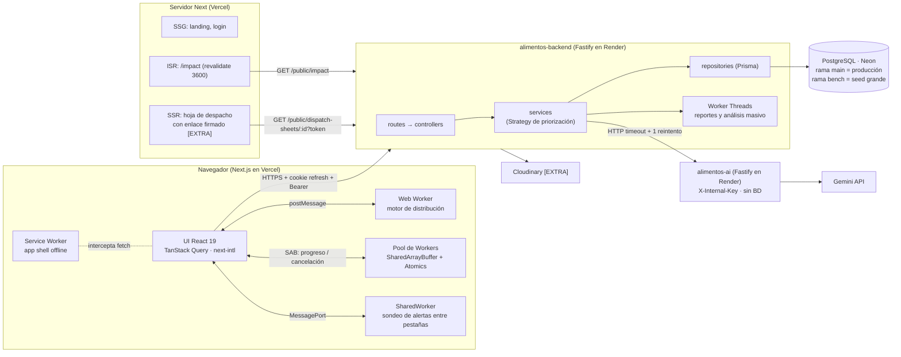
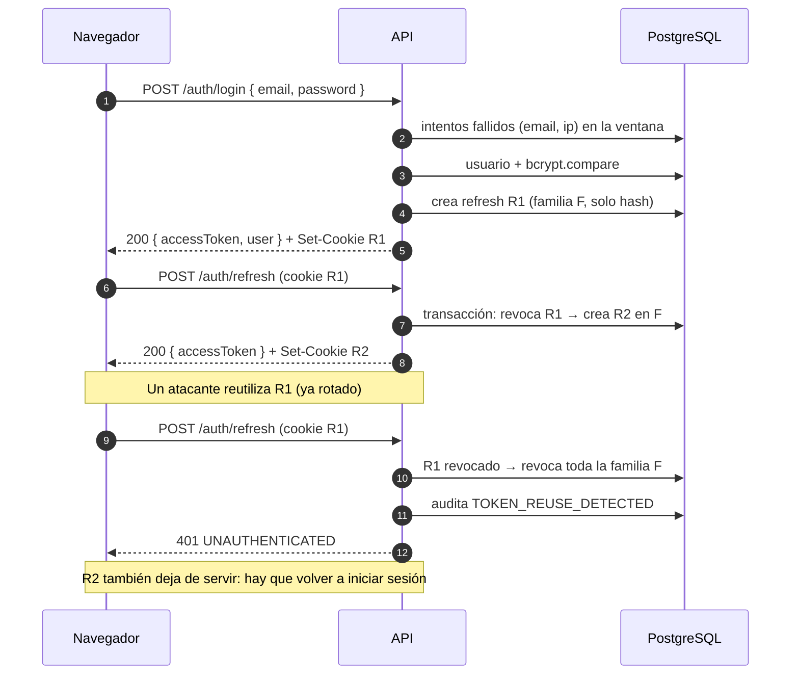

# alimentos-backend

API REST de **AlimentaIQ — Centro Inteligente de Distribución de Alimentos**. Gestiona productos,
inventario por lotes (FEFO), clientes, pedidos, propuestas de distribución, alertas, reportes y
métricas, y actúa como proxy hacia el servicio de IA (`alimentos-ai`).

- Stack: Node 22 LTS · Fastify 5 · TypeScript estricto · Zod · Prisma 5 · PostgreSQL (Neon).
- Despliegue: Render (API) · Neon (base de datos).
- Contrato completo: [docs/api-contract.md](docs/api-contract.md). No hay código compartido con
  `alimentos-frontend` ni con `alimentos-ai`.

## Arquitectura



Capas del backend: `route → controller → service → repository (Prisma)`.

## Módulos

| Módulo (`src/modules/`) | Responsabilidad                                                                           |
| ----------------------- | ----------------------------------------------------------------------------------------- |
| `health`                | Liveness (`/health`, sin BD) y readiness (`SELECT 1`)                                     |
| `auth`, `users`         | Login, refresh rotativo con detección de reutilización, logout, `/me`, límite de intentos |
| `audit`                 | Registro de acciones sensibles y su consulta (ADMIN)                                      |
| `products`, `inventory` | Catálogo, lotes, movimientos, métricas por producto (rotación, días de cobertura, riesgo) |
| `customers`, `orders`   | Clientes y pedidos con máquina de estados                                                 |
| `alerts`                | Alertas calculadas al vuelo (stock, vencimiento, riesgo de merma, pedidos por vencer)     |
| `distribution`          | Motor de propuestas (puro, en `domain/`), snapshot para el Web Worker, confirmación FEFO  |
| `ai`                    | Proxy hacia `alimentos-ai` con timeout, un reintento, caché y degradación                 |
| `reports`, `benchmarks` | CSV/PDF y benchmark, formateados en el pool de `worker_threads`                           |
| `metrics`, `public`     | Percentiles por ruta, Web Vitals y el agregado público de impacto                         |
| `admin`                 | `GET /admin/network-info` para fijar `TRUST_PROXY`                                        |

## Patrones

| Patrón         | Dónde                                                                                                                                                                                                               | Por qué                                                                                                                                                                           |
| -------------- | ------------------------------------------------------------------------------------------------------------------------------------------------------------------------------------------------------------------- | --------------------------------------------------------------------------------------------------------------------------------------------------------------------------------- |
| **Repository** | Interfaz en `src/modules/*/*.repository.ts`, Prisma en `*.prisma-repository.ts`, en memoria en `tests/helpers/in-memory-*.ts`                                                                                       | Los servicios no conocen Prisma: las ~700 pruebas corren sin base de datos y las transacciones (salidas, confirmación) quedan encapsuladas en un solo lugar                       |
| **Service**    | `src/modules/*/*.service.ts`, creados con `create*Service(deps)` en `src/app.ts`                                                                                                                                    | Reglas de negocio con dependencias inyectadas (repositorios, reloj, zona horaria, pool): se prueban con un reloj fijo y fakes                                                     |
| **Strategy**   | `src/modules/distribution/domain/strategies.ts`: `PrioritizationStrategy` con `BalancedStrategy`, `UrgencyFirstStrategy`, `WasteFirstStrategy` y `AiAssistedStrategy`, elegidas por `createStrategy(name, weights)` | La priorización cambia sin tocar el motor (`build-proposal.ts`): cada estrategia es un puntaje ponderado; `AI_ASSISTED` usa los pesos de `BALANCED` y la IA solo reordena empates |
| Controller     | `src/modules/*/*.controller.ts`                                                                                                                                                                                     | Valida con Zod (params, query y body) y traduce a HTTP; nada de lógica                                                                                                            |
| Plugin         | `src/plugins/` (seguridad, auth, errores, Server-Timing, métricas)                                                                                                                                                  | Comportamiento transversal registrado una vez                                                                                                                                     |

## Estructuras de datos

| Estructura               | Dónde                                                                     | Uso y justificación                                                                                                                                                                                               |
| ------------------------ | ------------------------------------------------------------------------- | ----------------------------------------------------------------------------------------------------------------------------------------------------------------------------------------------------------------- |
| `Map`                    | `distribution.service.ts`, `alerts.service.ts`, `products` (métricas)     | Índices por id (pedido, producto, salida de 30 días) construidos una vez: búsquedas O(1) en lugar de recorrer listas dentro de bucles (evita O(n·m) y el N+1 de los listados)                                     |
| **MinHeap**              | `src/modules/distribution/domain/min-heap.ts`                             | Cola de prioridad de pedidos en `build-proposal.ts`: sacar el más urgente es O(log n); al cambiar el stock se vuelve a puntuar de forma perezosa (solo el que sale) en vez de reordenar todo, O(n log n) en total |
| **Lotes ordenados FEFO** | `src/modules/inventory/domain/fefo.ts`, `distribution/domain/lot-book.ts` | Lotes por producto ordenados por vencimiento (y recepción): se consume siempre desde el frente, O(1) por asignación; garantiza "primero en vencer, primero en salir" y deja fuera lo que vence hoy                |
| **Buffer circular**      | `src/modules/metrics/domain/ring-buffer.ts`                               | Últimas 500 duraciones por ruta y 2.000 Web Vitals: inserción O(1) y memoria acotada aunque el servidor reciba millones de peticiones; los percentiles se calculan solo al consultar                              |
| **Cola FIFO del pool**   | `src/workers/pool.ts`                                                     | Tareas pendientes de los `worker_threads`: una por worker libre, en orden de llegada, con timeout por tarea; la petición HTTP espera su promesa sin bloquear el event loop                                        |

## Concurrencia y métricas

- **Event loop libre**: el formateo de reportes y el benchmark corren en el pool de
  `worker_threads` (§ Worker threads). El benchmark mide la diferencia: con 30.000 pedidos el hilo
  principal bloquea ~1,2 s; con el pool, la sonda de 10 ms se retrasa ~15 ms.
- **Sin carreras en el stock**: salidas y confirmaciones descuentan con
  `updateMany({ where: { id, quantity: { gte } } })` dentro de una transacción (concurrencia
  optimista); si otra petición ganó, 409 sin cambios parciales. `CHECK (quantity >= 0)` como
  defensa extra.
- **Propuestas obsoletas**: confirmar compara el snapshot guardado con el stock y los pedidos
  actuales; si cambiaron, 409 `STALE_PROPOSAL`.
- **Uno a la vez** donde importa: el benchmark (409 `BENCHMARK_RUNNING`), el refresh por familia de
  tokens.
- **Métricas**: `Server-Timing` en cada respuesta, p50/p95/p99 por patrón de ruta, lag del event
  loop (`monitorEventLoopDelay`), memoria y Web Vitals del frontend (§ Métricas).

## Seguridad

- `bodyLimit` de 1 MiB (413 `PAYLOAD_TOO_LARGE`), validación Zod en todas las entradas, helmet
  (HSTS, `nosniff`, `X-Frame-Options`, CORP `cross-origin` para el frontend aislado), CORS con
  lista exacta de orígenes, cookie de refresh `HttpOnly; Secure; SameSite=None; Path=/api/v1/auth`,
  logs con contraseñas, tokens, `Authorization` y cookies redactados, y errores 500 sin mensaje ni
  stack en producción.
- `TRUST_PROXY` (`true` o número de saltos) y `GET /api/v1/admin/network-info` para fijarlo (ver
  [docs/deployment.md](docs/deployment.md#6-trust_proxy-en-render)).
- **Matriz de roles**: [docs/role-matrix.md](docs/role-matrix.md), generada desde
  `tests/role-matrix.cases.ts`. `tests/role-matrix.test.ts` envía las 43 rutas × {anónimo,
  OPERATOR, ADMIN} y falla si una ruta nueva no está en la tabla.

## Pruebas

```bash
npm test                                   # todas (Vitest, sin base de datos)
npx vitest run tests/role-matrix.test.ts   # un archivo
npx vitest --watch                         # modo watch
npm run docs:role-matrix                   # regenera docs/role-matrix.md tras cambiar la tabla
```

Las pruebas construyen la app real (`buildApp`) con repositorios en memoria y la recorren con
`app.inject`: rutas, roles, transacciones simuladas, motor de distribución con fixtures de paridad
con el frontend, worker threads reales, reportes, seeds y el smoke de producción (que corre contra
la app en memoria con un `fetch` sobre `inject`). CI ejecuta lint, formato, typecheck, pruebas y
build en cada push.

## Endpoints disponibles

| Método | Ruta                                         | Respuesta                                                                                                |
| ------ | -------------------------------------------- | -------------------------------------------------------------------------------------------------------- |
| GET    | `/health`                                    | `{ status: "ok", service, version, uptimeSec }` (sin BD; Render)                                         |
| GET    | `/api/v1/health`                             | Igual que `/health`                                                                                      |
| GET    | `/api/v1/health/ready`                       | `{ status: "ok", db: "up" }` o 503 `{ status: "degraded", db: "down" }`                                  |
| POST   | `/api/v1/auth/login`                         | `{ accessToken, user }` + cookie `refresh_token`                                                         |
| POST   | `/api/v1/auth/refresh`                       | `{ accessToken }` + cookie rotada                                                                        |
| POST   | `/api/v1/auth/logout`                        | 204 y cookie borrada                                                                                     |
| GET    | `/api/v1/auth/me`                            | `{ data: { id, email, name, role } }` (Bearer)                                                           |
| GET    | `/api/v1/audit-logs`                         | Lista paginada; solo `ADMIN`; filtros `action`, `userId`, `from`, `to`                                   |
| GET    | `/api/v1/products`                           | Lista paginada con métricas; filtros `search`, `category`, `status`, `stockStatus`, `expiringWithinDays` |
| GET    | `/api/v1/products/:id`                       | `{ data }` con métricas y `lots[]` en orden FEFO                                                         |
| POST   | `/api/v1/products`                           | Solo `ADMIN`; 201; nombre repetido → 409 `DUPLICATE`                                                     |
| PATCH  | `/api/v1/products/:id`                       | Solo `ADMIN`; campos editables y `status` (no hay borrado físico)                                        |
| GET    | `/api/v1/inventory/lots`                     | Lotes con stock; filtros `productId`, `expiringWithinDays`, `includeExpired`                             |
| POST   | `/api/v1/inventory/entries`                  | Solo `ADMIN`; lote + movimiento `ENTRY` + auditoría (una transacción)                                    |
| POST   | `/api/v1/inventory/exits`                    | Solo `ADMIN`; `EXIT_WASTE` o `ADJUSTMENT`, con `lotId` o FEFO; 409 si no alcanza                         |
| GET    | `/api/v1/inventory/movements`                | Solo `ADMIN`; filtros `productId`, `type`, `from`, `to`                                                  |
| GET    | `/api/v1/inventory/summary`                  | `{ data: { totalProducts, lowStock, outOfStock, expiringSoon, wasteRiskHigh } }`                         |
| GET    | `/api/v1/customers`                          | Solo `ADMIN`; lista paginada; filtros `search`, `type`, `status`                                         |
| GET    | `/api/v1/customers/:id`                      | Solo `ADMIN`; `{ data }`                                                                                 |
| POST   | `/api/v1/customers`                          | Solo `ADMIN`; 201                                                                                        |
| PATCH  | `/api/v1/customers/:id`                      | Solo `ADMIN`; incluye `status` (no hay borrado físico)                                                   |
| GET    | `/api/v1/orders`                             | Lista paginada; filtros `status` (varios), `priority`, `customerId`, `dueBefore`                         |
| GET    | `/api/v1/orders/:id`                         | `{ data }` con `items[]`, cliente e `history[]`                                                          |
| POST   | `/api/v1/orders`                             | Solo `ADMIN`; 201; pedido + ítems + historial + auditoría en una transacción; no reserva stock           |
| PATCH  | `/api/v1/orders/:id/status`                  | Máquina de estados; cancelar solo `ADMIN` (con `RETURN` a los lotes); 409 si no aplica                   |
| GET    | `/api/v1/alerts`                             | `{ data: Alert[] }` calculadas al vuelo, de la más grave a la menos grave                                |
| GET    | `/api/v1/distribution/snapshot`              | Pedidos `PENDING`, lotes despachables, salida 30 días, pesos y reglas (para el Web Worker)               |
| POST   | `/api/v1/distribution/proposals`             | `{ strategy, weights?, locale? }` → el servidor calcula y guarda la propuesta `DRAFT`                    |
| GET    | `/api/v1/distribution/proposals[/:id]`       | Listado paginado; detalle con líneas agrupadas por pedido                                                |
| POST   | `/api/v1/distribution/proposals/:id/confirm` | Una transacción: descuenta FEFO, `EXIT_DISPATCH`, pedidos a `IN_PREPARATION`; 409 `STALE_PROPOSAL`       |
| POST   | `/api/v1/distribution/proposals/:id/discard` | Solo `DRAFT`                                                                                             |
| POST   | `/api/v1/ai/proposals/:id/explanation`       | Explicación de la IA guardada en `aiInsight`; si existe la devuelve (`cached`); `?refresh=true`          |
| POST   | `/api/v1/ai/rescue-plan`                     | Solo `ADMIN`; acciones para productos con `wasteRisk = HIGH`                                             |
| POST   | `/api/v1/ai/briefing`                        | Resumen del día; el `OPERATOR` recibe solo datos operativos                                              |
| GET    | `/api/v1/reports/:kind`                      | Solo `ADMIN`; `inventory`, `orders`, `waste` en CSV o PDF                                                |
| GET    | `/api/v1/benchmarks/limits`                  | Solo `ADMIN`; `{ data: { minSize, maxSize } }` (respeta `BENCHMARK_MAX_SIZE`)                            |
| POST   | `/api/v1/benchmarks/worker-threads`          | Solo `ADMIN`; hilo principal vs pool                                                                     |
| GET    | `/api/v1/metrics/api`                        | Solo `ADMIN`; percentiles por ruta, memoria, lag y uptime                                                |
| POST   | `/api/v1/metrics/web-vitals`                 | `ADMIN` y `OPERATOR`; 204                                                                                |
| GET    | `/api/v1/metrics/web-vitals`                 | Solo `ADMIN`; p75 por métrica y página                                                                   |
| GET    | `/api/v1/public/impact`                      | Público; agregados de 30 días sin datos personales                                                       |
| GET    | `/api/v1/admin/network-info`                 | Solo `ADMIN` (auditado); `ip`, `ips` y `X-Forwarded-For` para fijar `TRUST_PROXY`                        |

Quién puede llamar qué: [docs/role-matrix.md](docs/role-matrix.md).

Todas las respuestas incluyen `Server-Timing: app;dur=<ms>`. Los errores siguen el formato
`{ "error": { "code", "message", "details" } }`.

## Requisitos

- Node 22 LTS (ver `.nvmrc`) y npm.
- Una base de datos PostgreSQL (rama `dev` de Neon para desarrollo).

## Puesta en marcha local

```bash
npm ci
cp .env.example .env   # y completa los valores
npx prisma generate
npx prisma migrate dev
npx prisma db seed     # crea o actualiza el ADMIN y el OPERATOR demo
npm run dev
curl -i http://localhost:4000/health
```

## Variables de entorno

Plantilla en [.env.example](.env.example). Nunca se commitean valores reales.

| Variable                 | Obligatoria | Uso                                                      |
| ------------------------ | ----------- | -------------------------------------------------------- |
| `NODE_ENV`               | Sí          | `development` · `test` · `production`                    |
| `PORT`                   | No          | Render lo inyecta; en local 4000 por defecto             |
| `DATABASE_URL`           | Sí          | Conexión pooled de Neon (la usa la app)                  |
| `DIRECT_URL`             | Sí          | Conexión directa de Neon (la usan las migraciones)       |
| `CORS_ORIGINS`           | Sí          | Orígenes permitidos separados por comas                  |
| `JWT_ACCESS_SECRET`      | Sí          | Firma del access token (mínimo 32 caracteres)            |
| `ACCESS_TOKEN_TTL`       | No          | Duración del access token (`15m` por defecto)            |
| `REFRESH_TOKEN_TTL_DAYS` | No          | Días de vida del refresh token (7 por defecto)           |
| `LOGIN_MAX_ATTEMPTS`     | No          | Intentos fallidos por email + IP (5 por defecto)         |
| `LOGIN_WINDOW_MINUTES`   | No          | Ventana del límite de intentos (15 por defecto)          |
| `APP_TIMEZONE`           | No          | Zona del calendario de negocio (`America/Bogota`)        |
| `SHEET_LINK_SECRET`      | [EXTRA]     | Enlaces firmados de hoja de despacho                     |
| `AI_SERVICE_URL`         | No          | URL de `alimentos-ai`; sin ella la IA queda desactivada  |
| `AI_INTERNAL_KEY`        | No          | Clave enviada en `X-Internal-Key` (igual en ambos repos) |
| `AI_TIMEOUT_MS`          | No          | Timeout por intento de la IA (15000 por defecto)         |
| `WORKER_POOL_SIZE`       | No          | Workers del pool de reportes y benchmark (2 por defecto) |
| `WORKER_TASK_TIMEOUT_MS` | No          | Timeout por tarea del pool (30000 por defecto)           |
| `TRUST_PROXY`            | No          | `true` (defecto) o número de saltos de proxy             |
| `BENCHMARK_MAX_SIZE`     | No          | Máximo del benchmark (30000; **8000 en Render gratis**)  |
| `CLOUDINARY_URL`         | [EXTRA]     | Fotos de productos                                       |
| `SEED_ADMIN_EMAIL`       | Seed        | Email del admin demo (sin valor por defecto)             |
| `SEED_ADMIN_PASSWORD`    | Seed        | 12+ caracteres con mayúscula, minúscula, número, símbolo |
| `SEED_OPERATOR_EMAIL`    | Seed        | Email del operador demo (sin valor por defecto)          |
| `SEED_OPERATOR_PASSWORD` | Seed        | Contraseña del operador demo (sin valor por defecto)     |

Si falta una variable obligatoria el servidor no arranca e indica cuál falta (sin mostrar valores).
Las `SEED_*` solo las valida el script de seed. `npm run smoke:prod` lee `SMOKE_BASE_URL`,
`SMOKE_FRONTEND_ORIGIN`, `SMOKE_AI_URL` (`--warm`) y `SMOKE_ADMIN_*` / `SMOKE_OPERATOR_*` (o las
`SEED_*`); ninguna va en Render.

## Scripts

| Script                                               | Descripción                             |
| ---------------------------------------------------- | --------------------------------------- |
| `npm run dev`                                        | Servidor en modo watch (`tsx watch`)    |
| `npm run build`                                      | Compila TypeScript a `dist/`            |
| `npm start`                                          | Ejecuta `dist/server.js`                |
| `npm test`                                           | Pruebas con Vitest (no requieren BD)    |
| `npm run lint`                                       | ESLint con reglas type-aware            |
| `npm run typecheck`                                  | `tsc --noEmit`                          |
| `npm run format`                                     | Formatea con Prettier                   |
| `npm run format:check`                               | Verifica el formato (lo usa CI)         |
| `npm run seed:bench`                                 | Seed grande para la rama `bench`        |
| `npm run seed:history`                               | Historial de entregas para la demo      |
| `npm run seed:refresh-demo -- --confirm-host=<host>` | Mueve las fechas de la demo a hoy       |
| `npm run smoke:prod [-- --warm]`                     | Smoke de un despliegue (o lo despierta) |
| `npm run docs:role-matrix`                           | Regenera `docs/role-matrix.md`          |

## Puertos

| Servicio             | Puerto local |
| -------------------- | ------------ |
| `alimentos-frontend` | 3000         |
| `alimentos-backend`  | 4000         |
| `alimentos-ai`       | 4100         |

## Migraciones

- Las migraciones se crean **solo** con `npx prisma migrate dev --name <nombre>` contra la rama
  `dev` de Neon (la que apunta tu `.env` local).
- Son **solo aditivas**: no se editan migraciones ya commiteadas ni se borran columnas o tablas en uso.
- Se aplican a producción **manualmente, desde local y antes de desplegar**:

```bash
DATABASE_URL=<main> DIRECT_URL=<main> npx prisma migrate deploy
```

donde `<main>` son las cadenas de conexión de la rama `main` de Neon (nunca se commitean).
Render no ejecuta migraciones.

## Despliegue en Render

| Ajuste        | Valor                                                          |
| ------------- | -------------------------------------------------------------- |
| Build Command | `npm ci --include=dev && npx prisma generate && npm run build` |
| Start Command | `npm start`                                                    |
| Health Check  | `/health`                                                      |
| `PORT`        | No se define: Render lo inyecta                                |

Las variables de entorno se configuran en el panel de Render. Guía completa (entornos, variables
por servicio, orden de despliegue, migraciones, rollback, seeds, calentamiento y límites del plan
gratis): [docs/deployment.md](docs/deployment.md).

## Autenticación

El frontend vive en `*.vercel.app` y la API en `*.onrender.com` (sitios distintos, sin dominio
propio). CORS usa una allowlist (`CORS_ORIGINS`) con `credentials: true`.

- **Access token**: JWT `{ sub, role }` firmado con `JWT_ACCESS_SECRET`, vida `ACCESS_TOKEN_TTL`.
  Va en `Authorization: Bearer`.
- **Refresh token**: opaco (48 bytes aleatorios en base64url). En la BD solo se guarda su hash
  SHA-256. Viaja **solo** en la cookie `refresh_token` (`HttpOnly; Secure; SameSite=None;
Path=/api/v1/auth; Max-Age = REFRESH_TOKEN_TTL_DAYS`), nunca en el body.
- **Rotación**: cada `/auth/refresh` revoca el token actual y crea uno nuevo en la misma familia,
  en una sola transacción. Si llega un token ya rotado (robado o reutilizado) se revoca **toda la
  familia** y se audita `TOKEN_REUSE_DETECTED`.
- **Contraseñas**: bcrypt con cost 12. Si el email no existe se compara igual contra un hash
  ficticio, para que el tiempo de respuesta no revele qué cuentas existen.
- **Errores uniformes**: email inexistente, contraseña incorrecta o usuario inactivo responden el
  mismo `401 INVALID_CREDENTIALS`.
- **Límite de intentos**: al llegar a `LOGIN_MAX_ATTEMPTS` fallos para el mismo email + IP dentro
  de `LOGIN_WINDOW_MINUTES`, el login responde `429 TOO_MANY_REQUESTS` con `Retry-After` y se
  audita `LOGIN_BLOCKED`. Un login correcto reinicia el contador. `trustProxy` está activo para que
  `request.ip` sea la IP real detrás del proxy de Render.
- **Autorización**: `app.authenticate` valida el Bearer (`401 TOKEN_EXPIRED` si expiró,
  `401 UNAUTHENTICATED` si es inválido) y `app.authorize('ADMIN')` responde `403 FORBIDDEN`. Los
  roles siempre se validan en el servidor.
- **Auditoría**: `AuditService.record(...)` guarda `LOGIN_SUCCESS`, `LOGIN_BLOCKED`,
  `TOKEN_REUSE_DETECTED` y `LOGOUT`. Nunca guarda contraseñas ni tokens en `metadata`.



### Usuarios demo (seed)

`npx prisma db seed` crea o actualiza (upsert por email) un `ADMIN` y un `OPERATOR` a partir de
`SEED_ADMIN_EMAIL`, `SEED_ADMIN_PASSWORD`, `SEED_OPERATOR_EMAIL` y `SEED_OPERATOR_PASSWORD`. No hay
valores por defecto: si falta alguna variable o la contraseña del admin es débil, falla con un
mensaje que nombra la variable sin mostrar su valor. Es idempotente y nunca imprime contraseñas.

### Catálogo e inventario demo (seed)

Después de los usuarios, el seed carga **56 productos** de una distribuidora colombiana: arroz,
fríjol, leche, queso campesino, huevos, pollo, papa pastusa, plátano, tomate, pan, atún, gaseosa,
etc. Cada uno tiene categoría, unidad y stock mínimo coherentes.

- **Solo si la tabla `products` está vacía**, crea en una transacción:
  - 1 a 3 lotes con stock por producto;
  - un historial de recepciones y despachos (`EXIT_DISPATCH`) de los últimos 29 días con rotación
    variada.
    Todas las fechas son relativas a "hoy" en `APP_TIMEZONE`, así que la demo siempre muestra stock
    bajo, productos agotados, vencimientos próximos, lotes vencidos y riesgo de desperdicio.
- Si ya hay productos, solo agrega los del catálogo que falten y no toca el inventario. Correrlo
  dos veces no duplica nada.
- Las cantidades salen de un generador pseudoaleatorio con semilla fija: son reproducibles.
- Los movimientos demo quedan a nombre del admin del seed.
- Seed grande (solo rama `bench` de Neon): `npm run seed:bench -- --confirm-host=<host>` crea
  ~2.000 productos, 20.000 lotes (con su movimiento `ENTRY`) y 5.000 pedidos `PENDING` con
  `createMany` por lotes de 1.000. Se niega si `--confirm-host` no coincide con el host de
  `DATABASE_URL` o si `NODE_ENV=production`, y no repite si ya existen productos `Bench …`. Muestra
  solo el host (nunca la URL) y el tiempo de cada tabla. Necesita el seed normal antes.

### Clientes y pedidos demo (seed)

- **15 clientes ficticios de Bogotá** de todos los tipos (supermercados, restaurantes, colegios,
  hospitales y dos bancos de alimentos); uno está `INACTIVE`. Solo si la tabla `customers` está vacía.
  Los emails usan el dominio reservado `example.com`.
- **Solo si la tabla `orders` está vacía**, crea en una transacción 35 pedidos `PENDING` y 2
  `CANCELLED` (sin movimientos), con 1 a 5 ítems e historial. Las fechas de entrega son relativas a
  hoy: 3 vencidos, 8 para hoy o mañana y el resto a 3–14 días.
- Los productos con stock bajo o agotados se piden por encima de lo disponible (`SHORTAGE_RISK` en
  al menos 3 productos) y los próximos a vencer también aparecen en pedidos.
- Correrlo otra vez no duplica ni cambia nada.

## Inventario

Cada producto tiene **lotes** (`InventoryLot`) con su fecha de vencimiento, y cada cambio de stock
queda como un **movimiento** (`InventoryMovement`) con su tipo, cantidad positiva, usuario y
motivo. Ningún producto se borra: se desactiva.

### Lógica pura y probada

`src/modules/inventory/domain/` no importa Prisma ni lee el reloj: recibe datos y devuelve
resultados.

- `allocateFefo(lots, qty, { today, includeExpired })` reparte una salida empezando por el lote que
  vence primero (desempate por recepción y luego por id) y devuelve las asignaciones y el
  faltante.
- `productMetrics({ minStock, lots }, salidas30d, today)` calcula `availableQty`, `nearestExpiry`,
  `stockStatus`, `avgDailyOut30d`, `coverageDays`, `wasteRisk` y `reasons[]` (códigos y
  parámetros, nunca texto). Los umbrales están en `INVENTORY_RULES` (`EXPIRY_WARNING_DAYS = 7`), y
  las alertas los reutilizarán.
- **Calendario**: "hoy" y los días hasta el vencimiento se calculan en `APP_TIMEZONE`
  (`America/Bogota`). A las 23:30 de Bogotá ya es el día siguiente en UTC, pero el sistema sigue
  usando la fecha de Bogotá. Un lote vence al terminar su `expiryDate`.
- **Cantidades**: `Decimal(12,3)` en la BD y `number` en el JSON. Las operaciones se hacen en
  milésimas enteras para evitar errores como `0.1 + 0.2 ≠ 0.3`.

### Salidas sin carreras

Una salida (`POST /inventory/exits`) se escribe en una transacción. Cada lote se descuenta con
`updateMany({ where: { id, quantity: { gte: qty } } })` y se verifica que actualizó una fila. Si
otra salida simultánea consumió el stock, PostgreSQL vuelve a evaluar la condición al liberar la
fila, la actualización afecta 0 filas y se hace rollback de todo. La respuesta es 409
`INSUFFICIENT_STOCK`, sin movimientos parciales. Es concurrencia optimista, sin locks explícitos.
Como defensa extra, la migración agrega `CHECK (quantity >= 0)` en los lotes.

### Listados sin N+1

`GET /products` calcula las métricas de toda la página con **dos consultas agregadas**:

- un `groupBy` de stock por producto y fecha de vencimiento;
- un `GROUP BY` en SQL de las salidas `EXIT_DISPATCH` de 30 días por producto.

Los dos resultados se combinan en un `Map<productId, …>`. Los filtros `stockStatus` y
`expiringWithinDays` dependen de esas métricas, así que se aplican después de calcularlas.

## Pedidos y alertas

- **Máquina de estados pura** (`src/modules/orders/domain/order-state-machine.ts`): la tabla de
  transiciones del contrato y `checkManualTransition(from, to, role)`. `PENDING → IN_PREPARATION`
  queda reservado a la confirmación de la propuesta de distribución.
- **Cambio de estado sin carreras**: `UPDATE ... WHERE id = ? AND status = <estado leído>`. Si
  otro usuario lo cambió antes, responde 409 y la transacción no escribe nada.
- **Cancelación**: `returnsForCancellation` calcula por lote lo despachado menos lo ya devuelto; la
  misma transacción suma esa cantidad a cada lote, escribe los `RETURN`, pone `allocatedQty` en 0 y
  registra historial y auditoría.
- **Alertas** (`src/modules/alerts/domain/alerts.ts`): `buildAlerts` es puro y reutiliza
  `productMetrics` e `INVENTORY_RULES`. El servicio hace cuatro consultas agregadas (stock por
  vencimiento, salidas, demanda pendiente con `groupBy` y pedidos próximos) y las une con un `Map`.

## Motor de distribución

- **Dominio puro** en `src/modules/distribution/domain/`: `MinHeap<T>` propio, `scoreOrder`,
  estrategias (`BalancedStrategy` 40/35/25, `UrgencyFirstStrategy` 20/70/10,
  `WasteFirstStrategy` 20/20/60, o pesos propios que sumen 100) y `buildProposal`.
- **Heap y re-puntuación perezosa**: cuando un pedido llega arriba se vuelve a puntuar con el
  stock que queda. Si otro pedido se llevó el lote que vencía primero, su presión de vencimiento
  baja y vuelve al heap (máx. 3 veces). Con un heap eso cuesta O(log n) por reinserción; con un
  arreglo ordenado habría que reordenar cada vez.
- **Lotes despachables**: vencen mañana o después. Lo que vence hoy no sale en un despacho.
- **Confirmación atómica**: estado `DRAFT` condicional, decrementos condicionales por lote,
  pedidos `PENDING` condicionales, movimientos, `allocatedQty`, historial y auditoría en una
  transacción. Cualquier cambio intermedio (otra salida, una cancelación, otra propuesta
  confirmada) da 409 `STALE_PROPOSAL` y no deja nada a medias.

### `AI_ASSISTED`

Calcula `BALANCED`, detecta los grupos de empate (|Δscore| < 2), pide a `alimentos-ai` el orden
de esos pedidos y la explicación, y vuelve a ejecutar el motor con `tieBreakRanks`: solo cambian
los empates. Si la IA falla o no está configurada, guarda el plan `BALANCED` con
`degraded: true` y `summary.aiError`. El usuario siempre recibe propuesta.

### Fixtures de paridad (para el frontend)

`tests/fixtures/distribution-parity/*.json` tiene casos con `snapshot` de entrada y `expected`
(`ranking`, `lines`, `summary` sin `processingMs`), uno por estrategia:

| Archivo                                | Qué cubre                                                             |
| -------------------------------------- | --------------------------------------------------------------------- |
| `01-balanced-rescoring.json`           | Re-puntuación perezosa, stock parcial y `NO_STOCK`                    |
| `02-urgency-first-expiring-today.json` | Pedido vencido primero, lote que vence hoy excluido, FEFO entre lotes |
| `03-waste-first-custom-weights.json`   | Pesos propios 10/30/60, decimales y desempates                        |

El frontend **copia** estos archivos (los repos no comparten código) y ejecuta su copia del motor
en el Web Worker con `now = () => 0`: el resultado debe ser idéntico. Si cambia el algoritmo, se
regeneran aquí, se revisan a mano y se vuelven a copiar al frontend.

## IA (`alimentos-ai`)

El backend es el único que llama a `alimentos-ai` (`src/modules/ai/`). El cliente web solo envía
IDs y `locale`; el contexto se arma desde la BD.

- **Opcional**: sin `AI_SERVICE_URL` o `AI_INTERNAL_KEY` la IA queda "no configurada": el resto
  funciona, `AI_ASSISTED` se degrada y `/ai/*` responde 503 `AI_UNAVAILABLE` `NOT_CONFIGURED`.
- **Cliente HTTP**: `X-Internal-Key`, timeout por intento (`AI_TIMEOUT_MS`, 15 s), 1 reintento
  solo ante `TIMEOUT`, `UPSTREAM_ERROR` o error de red; respuestas validadas con Zod.
- **Enfriamiento**: tras `QUOTA_EXCEEDED` no llama hasta que pase `Retry-After` (o 60 s).
- **Datos mínimos**: los clientes viajan como tipo (`HOSPITAL`, `SCHOOL`…), nunca nombre, email
  ni teléfono; el briefing manda conteos de alertas, no las alertas.
- **Caché**: la explicación se guarda en `DistributionProposal.aiInsight` (columna `Json?`).
- **Límite**: 10 llamadas por minuto y usuario a `/ai/*` → 429 con `Retry-After`.
- **Auditoría**: `AI_REQUESTED` con endpoint, categoría y latencia, sin el contenido.

En local: `alimentos-ai` en el puerto 4100, `AI_SERVICE_URL=http://localhost:4100` y la misma
`AI_INTERNAL_KEY` en los dos `.env`.

## Worker threads, reportes y benchmark

- **Pool propio** (`src/workers/`, sin librerías): `WORKER_POOL_SIZE` workers (2), cola FIFO, una
  tarea por worker, timeout por tarea (`WORKER_TASK_TIMEOUT_MS`) y reinicio del worker si muere o
  se pasa del tiempo (una tarea en un hilo no se puede detener: se termina el worker). Cada worker
  avisa `ready` al cargar y solo entonces recibe tareas, así su arranque nunca cuenta en el
  timeout. El servidor los arranca al iniciar; en las pruebas se crean al primer uso.
- **Desarrollo y producción**: `resolveWorkerEntry` detecta si corre desde `src/*.ts` (tsx,
  Vitest) o desde `dist/*.js`. En desarrollo el hilo arranca `tsx-bootstrap.ts` (type stripping
  de Node), que registra tsx con su API e importa `task-worker.ts`: el flag `--import tsx` no llega
  a los `worker_threads`. En producción Node ejecuta `dist/workers/task-worker.js` sin flags. Las
  dos rutas tienen pruebas (y se comprobaron a mano).
- **Tareas**: `buildReport` (CSV/PDF a partir de datos ya leídos en el hilo principal) y
  `heavyAnalysis` (métricas + `buildProposal` sobre un snapshot sintético determinista).
- **Reportes** `GET /api/v1/reports/{inventory|orders|waste}?format=csv|pdf&locale=es|en`
  (solo ADMIN): CSV con BOM, `;` o `,` según el idioma, escapado RFC 4180 y protección contra CSV
  injection; PDF con pdfkit, encabezado repetido por página, totales y numeración.
- **Benchmark** `POST /api/v1/benchmarks/worker-threads { size }` (solo ADMIN, 1.000 a
  `BENCHMARK_MAX_SIZE`, 30.000 por defecto y 8.000 recomendado en el plan gratis de Render): el
  modo hilo principal bloquea el servidor para todos, por eso el límite y uno a la vez (409).
  `GET /api/v1/benchmarks/limits` expone el máximo para que el frontend lo respete.

| Pedidos | Modo           | Duración | Lag máx. / p99 | Deriva de la sonda |
| ------- | -------------- | -------- | -------------- | ------------------ |
| 5.000   | Hilo principal | 256 ms   | 256 / 256 ms   | 246 ms             |
| 5.000   | Pool           | 214 ms   | 26 / 26 ms     | 16 ms              |
| 15.000  | Hilo principal | 533 ms   | 563 / 563 ms   | 523 ms             |
| 15.000  | Pool           | 557 ms   | 24 / 24 ms     | 18 ms              |
| 30.000  | Hilo principal | 1.202 ms | 1.207 / 1.207  | 1.196 ms           |
| 30.000  | Pool           | 1.212 ms | 25 / 24 ms     | 15 ms              |

(Local, Windows, Node 22; en Windows los timers tienen ~15,6 ms de granularidad, por eso el lag
base del pool ronda 15–25 ms.)

## Métricas e impacto público

- `GET /api/v1/metrics/api` (ADMIN): p50/p95/p99, conteo y 5xx por **patrón** de ruta (últimas
  500 duraciones en un buffer circular), memoria, lag del event loop y uptime.
- `POST /api/v1/metrics/web-vitals` (ADMIN y OPERATOR) y `GET` (ADMIN, p75 por métrica y página).
- `GET /api/v1/public/impact` (sin login): despachado y "rescatado" por unidad, entregas a tiempo y
  clientes atendidos por tipo en los últimos 30 días, sin datos personales;
  `Cache-Control: public, max-age=300`, caché de 60 s en el servidor y 60 peticiones/min por IP.

## CI

GitHub Actions en cada push y PR a `main`: `npm ci`, `npx prisma generate`, lint, formato,
typecheck, pruebas y build. Las pruebas no necesitan base de datos.
