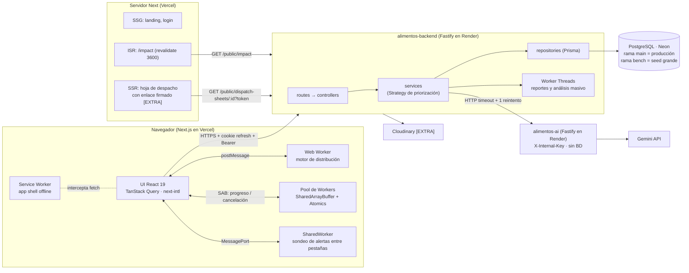
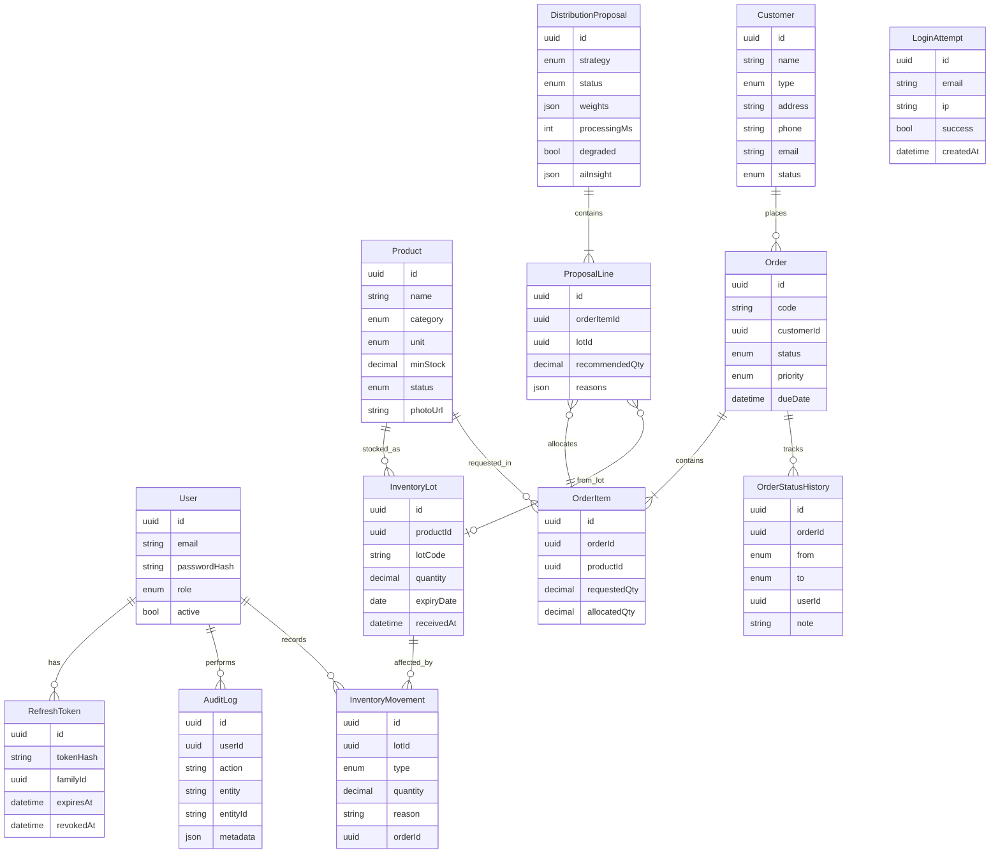
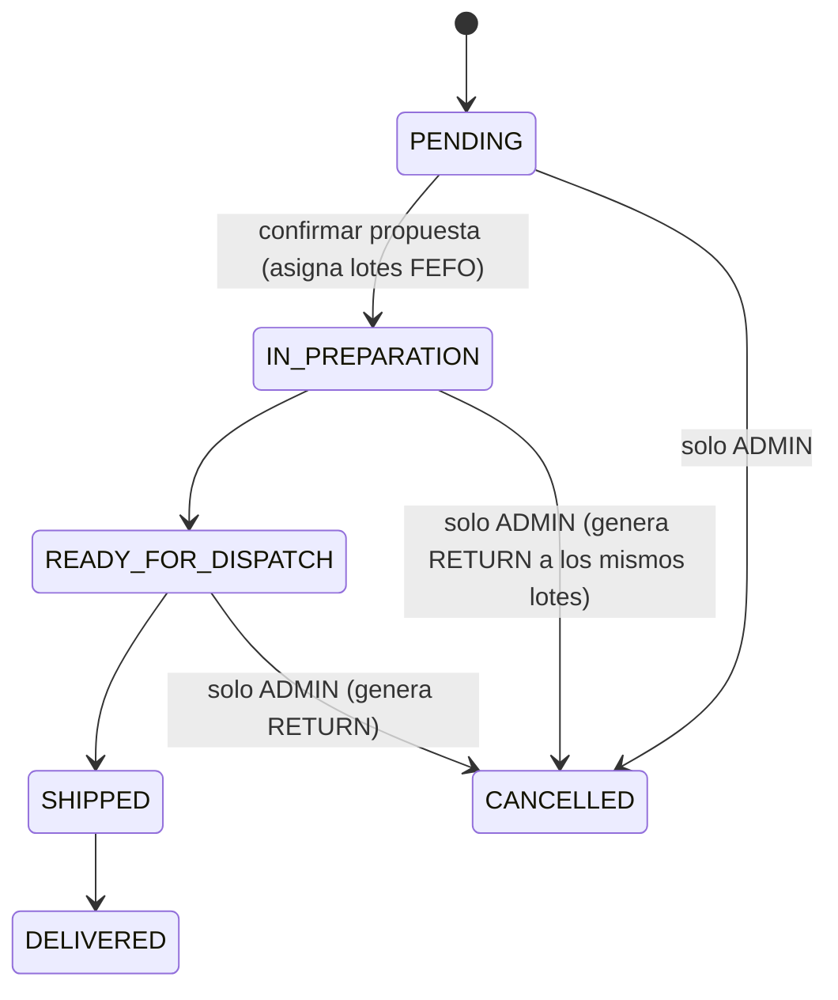

# AlimentaIQ — Contrato de API (v1)

> Fuente de verdad del contrato entre `alimentos-frontend`, `alimentos-backend` y `alimentos-ai`.
> No hay código compartido entre repos: cada repo copia en su README la parte del contrato que consume o expone.
> Etiquetas: **[OBL]** obligatorio según enunciado o reglas de clase · **[EXTRA]** recortable si falta tiempo.

---

## 1. Arquitectura



## 2. Modelo de datos



**Enums**

| Enum | Valores |
|---|---|
| `Role` | `ADMIN`, `OPERATOR` |
| `ProductCategory` | `FRUITS_VEGETABLES`, `DAIRY`, `MEAT_POULTRY`, `FISH`, `BAKERY`, `GRAINS_LEGUMES`, `CANNED`, `BEVERAGES`, `FROZEN`, `OTHER` |
| `Unit` | `KG`, `L`, `UNIT`, `BOX` (sin conversiones) |
| `ProductStatus` / `CustomerStatus` | `ACTIVE`, `INACTIVE` (no hay borrado físico) |
| `CustomerType` | `SUPERMARKET`, `RESTAURANT`, `SCHOOL`, `HOSPITAL`, `FOOD_BANK` |
| `OrderStatus` | `PENDING`, `IN_PREPARATION`, `READY_FOR_DISPATCH`, `SHIPPED`, `DELIVERED`, `CANCELLED` |
| `OrderPriority` | `LOW`, `MEDIUM`, `HIGH`, `URGENT` |
| `MovementType` | `ENTRY`, `EXIT_DISPATCH`, `EXIT_WASTE`, `ADJUSTMENT`, `RETURN` |
| `ProposalStatus` | `DRAFT`, `CONFIRMED`, `DISCARDED` |
| `Strategy` | `BALANCED`, `URGENCY_FIRST`, `WASTE_FIRST`, `AI_ASSISTED` (este último llega en la fase 3) |

**Máquina de estados de `Order`**



---

## 3. Convenciones

- Base: `/api/v1`. JSON en `camelCase`. IDs `uuid`. Códigos legibles de pedido: `PED-000123`.
- Fechas: `datetime` en ISO 8601 UTC; `expiryDate` y `dueDate` como `YYYY-MM-DD`.
- Cantidades: `Decimal(12,3)` en BD, `number` en JSON.
- Lista paginada: `?page=1&pageSize=20` → `{ "data": [...], "meta": { "page", "pageSize", "total" } }`.
- Recurso único: `{ "data": {...} }`.
- Error: `{ "error": { "code": "STRING", "message": "texto", "details": {} } }`.
- Justificaciones y alertas viajan como **códigos + parámetros** (`{ "code": "EXPIRES_IN_DAYS", "params": { "days": 3 } }`); el frontend las traduce con next-intl. El backend nunca envía texto traducido.
- Cada respuesta incluye `Server-Timing: app;dur=<ms>` para las métricas de tiempo de API.
- El cliente **nunca envía cifras calculadas**: puntajes, cantidades recomendadas y alertas los recalcula siempre el servidor.

**Códigos de error**

| HTTP | `code` |
|---|---|
| 400 | `VALIDATION_ERROR` |
| 401 | `UNAUTHENTICATED`, `INVALID_CREDENTIALS`, `TOKEN_EXPIRED` |
| 403 | `FORBIDDEN` |
| 404 | `NOT_FOUND` |
| 409 | `INVALID_STATUS_TRANSITION`, `INSUFFICIENT_STOCK`, `STALE_PROPOSAL`, `DUPLICATE`, `BENCHMARK_RUNNING` |
| 429 | `TOO_MANY_REQUESTS` (incluye `Retry-After`) |
| 503 | `AI_UNAVAILABLE` (con `details.category`) |
| 500 | `INTERNAL_ERROR` (error inesperado; sin detalles internos en producción) |

---

## 4. Endpoints del backend

Roles: **A** = ADMIN, **O** = OPERATOR, **P** = público.

### 4.1 Salud — [OBL]
| Método | Ruta | Rol | Respuesta |
|---|---|---|---|
| GET | `/health` | P | `{ status: "ok", service, version, uptimeSec }` (sin BD; para ping y Render) |
| GET | `/health/ready` | P | `{ status: "ok", db: "up" }` o 503 `{ status: "degraded", db: "down" }` |

### 4.2 Autenticación — [OBL] (igual que ObraIQ)
| Método | Ruta | Rol | Cuerpo → Respuesta |
|---|---|---|---|
| POST | `/auth/login` | P | `{ email, password }` → `{ accessToken, user }` + `Set-Cookie: refresh_token` (HttpOnly, Secure, SameSite=None, Path=/api/v1/auth). 429 tras N intentos fallidos por email+IP |
| POST | `/auth/refresh` | P (cookie) | → `{ accessToken }` + cookie rotada. Reuso de un refresh revocado → se revoca toda la familia |
| POST | `/auth/logout` | cookie (sin Bearer) | revoca la familia del refresh de la cookie y la borra; responde 204 aunque no haya cookie |
| GET | `/auth/me` | A, O | `{ id, email, name, role }` |

El access token va en `Authorization: Bearer`; vive en memoria con copia en sessionStorage.

El access token es un JWT `{ sub, role }` firmado con `JWT_ACCESS_SECRET` (duración `ACCESS_TOKEN_TTL`). El refresh token es **opaco** (48 bytes aleatorios en base64url): en la BD solo se guarda su hash SHA-256, viaja únicamente en la cookie `refresh_token` y dura `REFRESH_TOKEN_TTL_DAYS`. Cada refresh lo rota dentro de la misma familia; presentar uno ya rotado revoca toda la familia.

### 4.3 Productos — [OBL]
| Método | Ruta | Rol | Notas |
|---|---|---|---|
| GET | `/products` | A, O | filtros: `search, category, status, stockStatus=LOW\|OUT, wasteRisk=HIGH\|LOW\|NONE, expiringWithinDays` |
| GET | `/products/:id` | A, O | incluye `lots[]` ordenados por `expiryDate` |
| POST | `/products` | A | `{ name, category, unit, minStock }` |
| PATCH | `/products/:id` | A | campos editables + `status` |
| POST | `/products/:id/photo` | A | multipart → Cloudinary **[EXTRA]** |

`ProductDTO` incluye campos calculados: `availableQty`, `nearestExpiry`, `stockStatus` (`OK\|LOW\|OUT`), `avgDailyOut30d`, `coverageDays`, `wasteRisk` (`NONE\|LOW\|HIGH`).

- `name` es único sin distinguir mayúsculas ni espacios al inicio o al final: un nombre repetido da 409 `DUPLICATE`. No hay borrado: se desactiva con `PATCH { status: "INACTIVE" }`.
- `POST` y `PATCH` rechazan con 400 los campos desconocidos, incluidos los calculados: el cliente nunca los envía.
- Campos calculados extra: `expiredQty` (stock en lotes ya vencidos) y `daysToNearestExpiry`.
- `reasons[]` explica `stockStatus` y `wasteRisk` con códigos y parámetros.
- `stockStatus` y `expiringWithinDays` se filtran después de calcular las métricas.

**Reglas de cálculo** (en el calendario de `APP_TIMEZONE`; un lote vence al terminar su `expiryDate`):

| Campo | Regla |
|---|---|
| `availableQty` | Suma de los lotes no vencidos |
| `nearestExpiry` | `expiryDate` más próximo entre los lotes no vencidos con stock |
| `stockStatus` | `OUT` si `availableQty = 0`; `LOW` si `< minStock`; si no, `OK` |
| `avgDailyOut30d` | `EXIT_DISPATCH` de los últimos 30 días / 30 |
| `coverageDays` | `availableQty / avgDailyOut30d`; `null` si el promedio es 0 |
| `wasteRisk` | `HIGH` si hay stock no vencido y (promedio = 0 y el lote más próximo vence en ≤ `EXPIRY_WARNING_DAYS`, o `coverageDays` > días hasta ese vencimiento); `LOW` si vence en ≤ `EXPIRY_WARNING_DAYS`; si no, `NONE` |

`EXPIRY_WARNING_DAYS = 7`.

**Códigos de `reasons[]`** (`{ code, params }`)

| `code` | `params` |
|---|---|
| `OUT_OF_STOCK` | `{ minStock }` |
| `BELOW_MIN_STOCK` | `{ availableQty, minStock }` |
| `EXPIRES_IN_DAYS` | `{ days }` |
| `NO_RECENT_OUTFLOW` | `{ windowDays }` |
| `COVERAGE_EXCEEDS_EXPIRY` | `{ coverageDays, daysToExpiry }` |
| `EXPIRED_STOCK` | `{ quantity }` |

### 4.4 Inventario — [OBL]
| Método | Ruta | Rol | Notas |
|---|---|---|---|
| GET | `/inventory/lots` | A, O | filtros: `productId, expiringWithinDays, includeExpired` |
| POST | `/inventory/entries` | A | `{ productId, quantity, expiryDate, lotCode?, note? }` → crea lote + movimiento `ENTRY` (transacción) |
| POST | `/inventory/exits` | A | `{ productId, quantity, type: EXIT_WASTE\|ADJUSTMENT, lotId?, reason }`; sin `lotId` consume FEFO |
| GET | `/inventory/movements` | A | filtros: `productId, type, from, to` |
| GET | `/inventory/summary` | A, O | `{ totalProducts, lowStock, outOfStock, expiringSoon, wasteRiskHigh }` |

- **Lotes** (`LotDTO`): `{ id, productId, lotCode, quantity, initialQuantity, expiryDate, receivedAt, daysToExpiry, expired }`. Solo se listan lotes con stock, ordenados por `expiryDate`. Por defecto se ocultan los vencidos (`includeExpired=true` los incluye) y `expiringWithinDays=N` limita a los que vencen hasta hoy + N.
- **Entrada**: 201 `{ data: { lot, movement } }`.
  - `quantity > 0` con hasta 3 decimales.
  - `expiryDate` no puede estar en el pasado.
  - Un producto inexistente da 404 y uno inactivo, 400.
  - Lote, movimiento `ENTRY` y auditoría se escriben en una sola transacción.
- **Salida**: 201 `{ data: { allocations: [{ lotId, qty }], movements } }`. `reason` es obligatorio.
  - **Con `lotId`**: usa ese lote. Si el lote no pertenece al producto, 404.
  - **Sin `lotId`**: aplica FEFO (ordena por vencimiento, después por recepción). Ignora los lotes vencidos salvo en `EXIT_WASTE`, que los consume primero.
  - Cada lote se descuenta con una actualización condicional (`quantity >= qty`) dentro de una transacción. Si el stock no alcanza, o si otra salida simultánea lo consumió, responde 409 `INSUFFICIENT_STOCK` y no queda ningún movimiento parcial.
- **Resumen**: cuenta solo productos `ACTIVE`. `lowStock` excluye los `OUT`. `expiringSoon` = productos cuyo lote más próximo vence en ≤ `EXPIRY_WARNING_DAYS`.
- Cantidades: `Decimal(12,3)` en BD, `number` en JSON. `InventoryMovement.quantity` siempre es positiva; el `type` da la dirección. `orderId` es FK opcional a `Order` (solo `EXIT_DISPATCH` y `RETURN` de un pedido).

### 4.5 Clientes — [OBL]
| Método | Ruta | Rol |
|---|---|---|
| GET | `/customers` | A |
| GET | `/customers/:id` | A |
| POST | `/customers` | A |
| PATCH | `/customers/:id` | A (incluye `status`) |

- `CustomerDTO`: `{ id, name, type, address, phone, email, status, createdAt, updatedAt }`. `phone` y `email` son opcionales; en PATCH, `null` los borra. El email se guarda en minúsculas.
- Filtros de `GET /customers`: `search` (nombre, sin distinguir mayúsculas), `type`, `status` y paginación. Orden por nombre.
- Sin borrado físico: se desactiva con `PATCH { "status": "INACTIVE" }`. Un cliente inactivo no puede recibir pedidos nuevos.
- La auditoría guarda los nombres de los campos cambiados, nunca el teléfono ni el email.

### 4.6 Pedidos — [OBL]
| Método | Ruta | Rol | Notas |
|---|---|---|---|
| GET | `/orders` | A, O | filtros: `status, priority, customerId, dueBefore` |
| GET | `/orders/:id` | A, O | incluye `items[]` y `history[]` |
| POST | `/orders` | A | `{ customerId, priority, dueDate, items: [{ productId, quantity }] }` |
| PATCH | `/orders/:id/status` | A, O | `{ status, note? }`; valida la máquina de estados; `CANCELLED` solo A |

- `OrderDTO`: `{ id, code, number, customer: { id, name, type }, status, priority, dueDate, notes, itemCount, createdById, createdAt, updatedAt }`. `code` (`PED-000123`) se deriva del `number` secuencial. El detalle agrega `items[]` (`{ id, productId, productName, unit, requestedQty, allocatedQty }`) e `history[]` (`{ id, fromStatus, toStatus, userId, note, createdAt }`).
- **Listado**: `status` admite varios (`?status=PENDING,IN_PREPARATION` o repetido), `priority`, `customerId` y `dueBefore` (estrictamente antes de esa fecha). Orden: `dueDate` asc, después `priority` (URGENT primero) y `number`.
- **Creación** (201 con el detalle):
  - Cliente inexistente 404; inactivo 400. Productos inexistentes 404 (`details.productIds`); inactivos 400.
  - Sin productos repetidos, 1–50 ítems, cantidades > 0 con hasta 3 decimales.
  - `dueDate` ≥ hoy en `APP_TIMEZONE`.
  - No reserva stock. Pedido, ítems, historial (`null → PENDING`) y auditoría van en una transacción.
- **Cambio de estado**:
  - Por PATCH se permiten `IN_PREPARATION → READY_FOR_DISPATCH → SHIPPED → DELIVERED` (A, O) y `→ CANCELLED` desde `PENDING`, `IN_PREPARATION` y `READY_FOR_DISPATCH` (solo A).
  - `PENDING → IN_PREPARATION` no se hace por PATCH: lo hace la confirmación de la propuesta de distribución (4.7). Responde 409 `INVALID_STATUS_TRANSITION` con `details.reason = REQUIRES_PROPOSAL`.
  - Una transición que no existe (incluido quedarse en el mismo estado) da 409 con `reason = NOT_ALLOWED`. Se revisa antes que el rol: un OPERATOR que cancela un pedido `SHIPPED` recibe 409, no 403. Un OPERATOR que cancela un pedido cancelable recibe 403 `FORBIDDEN`.
  - El estado se actualiza solo si sigue siendo el leído (`WHERE id AND status`). Si otro usuario lo cambió antes, 409 con `reason = STATUS_CHANGED` y no se escribe nada.
  - **Cancelar** devuelve a cada lote lo que el pedido despachó de él (`EXIT_DISPATCH` menos `RETURN` previos) con movimientos `RETURN` y deja `allocatedQty` en 0, todo en la misma transacción que el historial y la auditoría.

### 4.7 Distribución — [OBL]
| Método | Ruta | Rol | Notas |
|---|---|---|---|
| GET | `/distribution/snapshot` | A, O | pedidos `PENDING` + lotes vigentes + demanda 30 días. Alimenta el **Web Worker** para simular en el navegador |
| POST | `/distribution/proposals` | A, O | `{ strategy, weights? }` → el servidor recalcula y guarda `DRAFT` |
| GET | `/distribution/proposals` | A, O | listado |
| GET | `/distribution/proposals/:id` | A, O | líneas con `requestedQty, availableQty, recommendedQty, score, reasons[]` |
| POST | `/distribution/proposals/:id/confirm` | A, O | transacción: revalida stock (si cambió → 409 `STALE_PROPOSAL`), crea `EXIT_DISPATCH` FEFO, llena `allocatedQty`, pasa pedidos a `IN_PREPARATION` |
| POST | `/distribution/proposals/:id/discard` | A, O | |
| POST | `/distribution/proposals/:id/sheet-link` | A, O | **[EXTRA]** → `{ url, expiresAt }` (enlace firmado de 10 min) |

**Algoritmo de reglas, transparente y configurable**

```
score = wP·priority + wD·deadlineUrgency + wE·expiryPressure      (0–100, 2 decimales)
priority        = LOW .25 · MEDIUM .5 · HIGH .75 · URGENT 1
deadlineUrgency = clamp(1 − díasHastaDueDate / 14, 0, 1)          (vencido = 1)
expiryPressure  = máx sobre los ítems de clamp(1 − díasHastaVencimientoDelLoteFEFO / 30, 0, 1)
```

| Estrategia (patrón Strategy) | wP / wD / wE | Para qué |
|---|---|---|
| `BALANCED` | 40 / 35 / 25 | Equilibrio por defecto |
| `URGENCY_FIRST` | 20 / 70 / 10 | Entregar a tiempo |
| `WASTE_FIRST` | 20 / 20 / 60 | Mover primero lo que vence |
| `AI_ASSISTED` | 40 / 35 / 25 | BALANCED + la IA reordena **solo los empates**; si la IA falla, BALANCED con `degraded: true` |

Se pueden enviar pesos propios `{ priority, deadlineUrgency, expiryPressure }`: no negativos, máx. 2 decimales y **suma exacta 100** (si no, 400 `VALIDATION_ERROR` con `details.problem`).

1. Todos los pedidos `PENDING` se puntúan y entran a un **min-heap** (mayor score primero; desempate estable: `dueDate`, luego `createdAt`, luego `number`).
2. Se saca el mejor y se **vuelve a puntuar** con el estado actual de los lotes (otro pedido pudo llevarse el lote que vencía antes). Si su score bajó y queda detrás del siguiente, vuelve al heap (**re-puntuación perezosa**, máx. 3 veces por pedido); si no, se atiende.
3. Cada ítem toma stock **FEFO** (`expiryDate`, luego `receivedAt`, luego `id`) de un `Map<lotId, restante>`.
4. **Lote despachable = vence mañana o después** (`expiryDate ≥ hoy + 1`; lo que vence hoy no se despacha). *Cambio frente a la versión anterior ("excluir los que vencen antes de `dueDate`")*: esa regla dejaba en bodega justo los lotes más próximos a vencer cuando el pedido era para más adelante, y terminaban en merma. Enviar antes lo que vence antes reduce la merma; lo que vence hoy queda para merma o uso del día.
5. Una línea por (ítem, lote) con `rank, score, requestedQty, availableQty` (stock despachable del producto cuando se atendió el ítem), `recommendedQty` y `reasons[]`: `PRIORITY_LOW|MEDIUM|HIGH|URGENT`, `DUE_IN_DAYS {days}`, `OVERDUE {days}`, `EXPIRES_IN_DAYS {days}`, `PARTIAL_STOCK {requested, allocated}`, `NO_STOCK {requested}` (línea sin lote y `recommendedQty = 0`).
6. `summary`: `ordersFull, ordersPartial, ordersUnserved, totalRecommended` (por unidad, nunca se suman unidades distintas), `itemsProcessed, linesCount, rescoreCount, processingMs`. Con `AI_ASSISTED` además `tieGroups` y, si la IA falló, `aiError` (categoría).

Es determinista: el mismo snapshot y la misma estrategia dan siempre el mismo plan, sin importar el orden de la entrada.

- **Snapshot** (`GET /distribution/snapshot`): `{ businessDate, orders[{ id, code, number, customerName, customerType, priority, dueDate, createdAt, items[{ id, productId, requestedQty }] }], lots[{ id, productId, quantity, expiryDate, receivedAt }], products[{ id, name, unit, avgDailyOut30d }], strategies, rules }`. Solo lotes despachables con stock. Cuatro consultas en total, sin N+1.
- **Generar** (`POST /proposals`, 201): el cliente solo envía `{ strategy, weights?, locale? }` (`locale` `es|en`, por defecto `es`, idioma de la explicación de `AI_ASSISTED`); cualquier otra cifra es 400. El servidor arma el snapshot, calcula y guarda `DRAFT` + líneas + auditoría.
- **Detalle** (`GET /proposals/:id`): líneas agrupadas por pedido en orden de `rank`, con `customerType`, `components`, `fulfillment: FULL|PARTIAL|UNSERVED`, `rescores` y el estado actual del pedido. La propuesta trae `degraded` y `aiInsight` (`null` o `{ summary, highlights[], tieBreakOrder?, locale, model, promptVersion?, latencyMs, generatedAt }`).
- **Confirmar** (`POST /:id/confirm`), en **una transacción**:
  1. `DRAFT → CONFIRMED` condicional (si no estaba en DRAFT → 409 `STALE_PROPOSAL` `reason: NOT_DRAFT`).
  2. Por cada línea con `recommendedQty > 0`: decremento condicional del lote (`quantity >= qty`); si falla → 409 `STALE_PROPOSAL` `reason: STOCK_CHANGED` con `{ lotId, productId }`.
  3. Cada pedido con asignación pasa `PENDING → IN_PREPARATION` de forma condicional (si ya no estaba `PENDING` → 409 `reason: ORDER_CHANGED` con `{ orderId }`) + historial con nota `proposal:<id>`. Los pedidos sin asignación siguen `PENDING`.
  4. Movimientos `EXIT_DISPATCH` con `orderId`, `allocatedQty += cantidad`, auditoría `PROPOSAL_CONFIRMED`.
  Cualquier 409 deshace todo: no quedan cambios parciales. Una propuesta de otro día de negocio responde 409 `reason: BUSINESS_DATE_CHANGED` (los lotes despachables dependen de la fecha).
- **Descartar** (`POST /:id/discard`): solo `DRAFT`; si no, 409 `INVALID_STATUS_TRANSITION`.

`AI_ASSISTED` (patrón Strategy, mismos pesos que `BALANCED`):

1. Calcula el plan `BALANCED` y detecta los **grupos de empate**: pedidos ordenados por score donde cada uno queda a menos de 2 puntos del anterior (|Δscore| < 2), la misma regla que usa `alimentos-ai`.
2. Pide a la IA la explicación y `tieBreakOrder` (lista de `orderCode`).
3. Vuelve a ejecutar el motor con `tieBreakRanks` (`Map<orderCode, rank>`): dentro de un grupo de empate decide el rango de la IA (antes que `dueDate`); los pedidos que la IA no ordenó van después; entre grupos y para los demás pedidos el comparador no cambia. El dominio sigue puro y síncrono.
4. Guarda la explicación en `aiInsight`.

Si la IA falla (o no está configurada) → plan `BALANCED` con `degraded: true` y `summary.aiError = <categoría>`. El usuario siempre recibe propuesta (201).

> El mismo algoritmo existe en el backend y en el Web Worker del frontend (no hay código compartido). La paridad se verifica con los fixtures de `alimentos-backend/tests/fixtures/distribution-parity/`, que el frontend copia y ejecuta en sus pruebas.

### 4.8 Alertas — [OBL]
| Método | Ruta | Rol |
|---|---|---|
| GET | `/alerts` | A, O |

Se calculan al vuelo, no se guardan. Cada alerta: `{ type, severity: INFO|WARNING|CRITICAL, entity, entityId, code, params }`.

| `type` | Regla |
|---|---|
| `LOW_STOCK` | `availableQty < minStock` |
| `EXPIRING_SOON` | lote vence en ≤ `EXPIRY_WARNING_DAYS` (7) |
| `WASTE_RISK` | `coverageDays > díasHastaVencimiento` (baja rotación + vencimiento cercano) |
| `SHORTAGE_RISK` | demanda pendiente del producto > `availableQty` |
| `ORDER_DUE_SOON` | pedido no despachado con `dueDate` en ≤ 2 días |

Respuesta: `{ "data": Alert[] }`, ordenadas por severidad (CRITICAL primero), después por tipo y `entityId`. Solo productos `ACTIVE`. Fechas en `APP_TIMEZONE`.

| `type` | `severity` | `code` | `params` |
|---|---|---|---|
| `LOW_STOCK` | WARNING; CRITICAL si `OUT` | `BELOW_MIN_STOCK` / `OUT_OF_STOCK` | `{ name, availableQty, minStock }` / `{ name, minStock }` |
| `EXPIRING_SOON` | WARNING; CRITICAL si vence en ≤ 2 días | `EXPIRES_IN_DAYS` | `{ name, days, expiryDate }` (lote más próximo) |
| `WASTE_RISK` | CRITICAL (solo `wasteRisk = HIGH`) | `COVERAGE_EXCEEDS_EXPIRY` / `NO_RECENT_OUTFLOW` | los de la razón (4.3) + `name` |
| `SHORTAGE_RISK` | WARNING | `PENDING_DEMAND_EXCEEDS_STOCK` | `{ name, demand, available }` (`demand` = suma de `requestedQty` en pedidos `PENDING`) |
| `ORDER_DUE_SOON` | WARNING; CRITICAL si ya venció | `ORDER_DUE_IN_DAYS` / `ORDER_OVERDUE` | `{ orderCode, days }` / `{ orderCode, daysOverdue }` |

"No despachado" = `PENDING`, `IN_PREPARATION` o `READY_FOR_DISPATCH`. Umbrales en `ALERT_RULES` (`CRITICAL_EXPIRY_DAYS = 2`, `ORDER_DUE_SOON_DAYS = 2`) sobre `INVENTORY_RULES`. Las métricas salen de `productMetrics`, así que alertas y `ProductDTO` nunca se contradicen.

### 4.9 IA (proxy del backend)
| Método | Ruta | Rol | Etiqueta |
|---|---|---|---|
| POST | `/ai/proposals/:id/explanation` | A, O | [OBL] |
| POST | `/ai/rescue-plan` | A | [OBL] productos con `WASTE_RISK` → acciones sugeridas |
| POST | `/ai/briefing` | A, O | [EXTRA] resumen del día |

El cliente solo envía IDs (en la ruta) y `{ locale?: "es" | "en" }` (por defecto `es`). El backend arma el contexto desde la BD, filtrado por rol y **sin datos personales** de clientes (viaja el tipo de cliente, nunca nombre, email ni teléfono).

| Ruta | Contexto que arma el backend |
|---|---|
| `/ai/proposals/:id/explanation` | Una línea por ítem (los lotes se suman): `orderCode, customerType, product, requestedQty, recommendedQty, score, reasons`. Guarda la respuesta en `aiInsight`; si ya existe en ese `locale` la devuelve con `cached: true` sin llamar a la IA. `?refresh=true` la regenera. Propuesta sin líneas → 400 `VALIDATION_ERROR` `reason: EMPTY_PROPOSAL` |
| `/ai/rescue-plan` | Productos `ACTIVE` con `wasteRisk = HIGH` (mismas métricas que las alertas): `name, category, qty, unit, daysToExpiry, avgDailyOut`, + tipos de los clientes activos. Sin productos en riesgo → 200 `{ actions: [] }` sin llamar a la IA (`model: null`) |
| `/ai/briefing` | Conteos de alertas por `(type, severity, code)` (nunca las alertas con nombres), top 10 pedidos `PENDING` por score `BALANCED` y KPIs de `/inventory/summary` + `pendingOrders`. El OPERATOR recibe solo datos operativos: sin alertas `WASTE_RISK`, sin `customerType` y solo los KPIs `lowStock, outOfStock, expiringSoon, pendingOrders` |

- Respuesta: `{ "data": {...}, "meta": { "model", "latencyMs", "cached" } }`.
- Error: 503 `AI_UNAVAILABLE` con `details.category`: `NOT_CONFIGURED` (faltan `AI_SERVICE_URL` / `AI_INTERNAL_KEY`), `TIMEOUT`, `UPSTREAM_ERROR`, `QUOTA_EXCEEDED` (con `Retry-After` y `details.retryAfterSec`), `INVALID_API_KEY`, `MODEL_NOT_FOUND`. La UI muestra el resultado de reglas.
- Límite: 10 llamadas por minuto y usuario a `/ai/*` (en memoria, ventana deslizante) → 429 `TOO_MANY_REQUESTS` con `Retry-After`. Se cuenta después de `authorize`: un 403 no gasta cupo.
- Auditoría `AI_REQUESTED` por cada llamada real: `{ endpoint, category: OK|<categoría>, latencyMs, model? }`, nunca el contenido.
- Excepción a "el backend nunca envía texto traducido": el texto de la IA llega en el idioma pedido, en texto plano.

### 4.10 Reportes y métricas
| Método | Ruta | Rol | Etiqueta |
|---|---|---|---|
| GET | `/reports/inventory?format=csv\|pdf&locale=es\|en` | A | [OBL] productos activos con métricas |
| GET | `/reports/orders?from&to&format&locale` | A | [OBL] pedidos creados en el rango |
| GET | `/reports/waste?from&to&format&locale` | A | [OBL] `EXIT_WASTE` del rango + productos con `wasteRisk = HIGH` hoy |
| GET | `/metrics/api` | A | [OBL] p50/p95/p99, conteo y 5xx por patrón de ruta + memoria, lag del event loop y uptime |
| POST | `/metrics/web-vitals` | A, O | [OBL] `{ name, value, rating, page }` → 204 |
| GET | `/metrics/web-vitals` | A | [OBL] p75 por métrica y por página |
| POST | `/benchmarks/worker-threads` | A | [OBL] `{ size }` → hilo principal vs pool de workers |

**Reportes** (los datos se leen en el hilo principal; el formateo CSV/PDF se hace en el pool de `worker_threads`):

- `format` `csv` (por defecto) o `pdf`; `locale` `es` (por defecto) o `en`; `from`/`to` (`YYYY-MM-DD`, días de negocio en `APP_TIMEZONE`, ambos incluidos; por defecto los últimos 30 días; máximo 366). Cualquier otro parámetro → 400.
- CSV: UTF-8 **con BOM** (Excel muestra las tildes), separador `;` y coma decimal con `locale=es`, `,` y punto decimal con `locale=en`, campos con separador/comillas/saltos entre comillas y comillas duplicadas, y **protección contra CSV injection**: las celdas de texto que empiezan por `= + - @`, tabulador o retorno de carro llevan un `'` delante. Los números nunca se modifican.
- PDF (pdfkit): título, fecha de generación en hora de Bogotá, tabla paginada con el encabezado repetido, totales (por unidad, nunca sumando unidades distintas) y "Página X de Y".
- Headers: `Content-Disposition: attachment; filename="alimentaiq-<reporte>-<fecha o rango>.<csv|pdf>"`, `X-Generation-Time-Ms` (lectura + formateo), `Server-Timing: db;dur=…, render;dur=…, app;dur=…` y `Cache-Control: no-store`. Cada descarga deja `REPORT_EXPORTED` en la auditoría (tipo, formato, filas; nunca el contenido).
- Es el único lugar donde el backend escribe texto traducido: un archivo lo lee una persona fuera de la app.

**Benchmark** `POST /benchmarks/worker-threads` `{ size }` (entero de 1.000 a **30.000** pedidos sintéticos):

- Ejecuta `heavyAnalysis` (métricas de producto + `buildProposal` sobre un snapshot sintético determinista) primero en el hilo principal y luego en el pool. En cada modo mide la duración, el lag del event loop (`monitorEventLoopDelay`: máx. y p99) y la deriva de una "sonda" `setInterval` de 10 ms (cuánto tarda el servidor en volver a atender).
- El límite de 30.000 existe porque el modo hilo principal **bloquea el servidor para todos** mientras dura (≈1,1 s en un portátil, ≈2 s en una instancia pequeña).
- Uno a la vez: si hay otro corriendo → 409 `BENCHMARK_RUNNING`.
- Respuesta: `{ size, mainThread, workerPool, sameResult, result, mainThreadMs, workerMs, eventLoopLagMain, eventLoopLagWorker }` (los cuatro últimos son el resumen original del contrato). Auditoría `BENCHMARK_RUN`.

**Métricas**: un hook `onResponse` guarda por patrón de ruta (`GET /api/v1/orders/:id`, nunca la URL con IDs) las últimas 500 duraciones; `GET /metrics/api` da p50/p95/p99, el total y los 5xx de cada ruta, `process.memoryUsage()`, el lag del event loop (media, p99, máx.) y el uptime. Web vitals: `name` ∈ `INP, LCP, CLS, TTFB, FCP`, `value` 0–60.000, `rating` ∈ `good, needs-improvement, poor`, `page` = ruta sin query ni host (sin datos personales); se guardan las últimas 2.000 muestras. Todo en memoria y por proceso.

### 4.11 Público
| Método | Ruta | Rol | Etiqueta |
|---|---|---|---|
| GET | `/public/impact` | P | [OBL] agregados sin datos personales; consumido por ISR |
| GET | `/public/dispatch-sheets/:id?token=` | P (token) | [EXTRA] consumido por SSR |

`GET /public/impact` (sin autenticación) → `{ data: { windowDays: 30, from, to, dispatched, rescued, rescueDays: 7, deliveries: { total, onTime, onTimePct }, customersServed: { total, byType }, generatedAt } }`:

- `dispatched`: cantidad de `EXIT_DISPATCH` de los últimos 30 días **por unidad** (`{ KG, L, UNIT, BOX }`).
- `rescued`: de esa cantidad, la despachada de lotes que estaban a ≤ 7 días de vencer el día del despacho.
- `deliveries`: pedidos que pasaron a `DELIVERED` en la ventana y cuántos llegaron hasta su `dueDate` (`onTimePct` con 1 decimal, `null` sin entregas).
- `customersServed`: clientes distintos con entregas, contados por tipo. Nunca nombres, IDs, emails ni teléfonos.
- `Cache-Control: public, max-age=300` + caché de 60 s en el servidor. Límite: 60 peticiones por minuto e IP → 429 con `Retry-After`.

### 4.12 Administración
| Método | Ruta | Rol | Etiqueta |
|---|---|---|---|
| GET | `/audit-logs` | A | [OBL] |
| GET/POST/PATCH | `/users` | A | [EXTRA] (las cuentas salen del seed) |

---

## 5. Contrato backend → `alimentos-ai`

- Header `X-Internal-Key` (comparación timing-safe en `alimentos-ai`); el valor sale de `AI_INTERNAL_KEY` y nunca se registra.
- Cliente del backend (`src/modules/ai/ai-client.ts`): timeout `AI_TIMEOUT_MS` (15 s por defecto) por intento con `AbortController`, **1 reintento** solo ante `TIMEOUT`, `UPSTREAM_ERROR` o error de red (también un 5xx desconocido). No reintenta `QUOTA_EXCEEDED`, `INVALID_API_KEY`, `MODEL_NOT_FOUND`, la clave interna rechazada (401) ni un 400.
- **Enfriamiento por cuota**: tras `QUOTA_EXCEEDED` el backend no vuelve a llamar hasta que pase `Retry-After` (o 60 s); mientras tanto responde `QUOTA_EXCEEDED` sin llamar. Estado en memoria.
- El backend valida cada respuesta con Zod; si no cuadra → `UPSTREAM_ERROR`.
- Modelo por variable `GEMINI_MODEL`. Salida JSON validada con Zod en ambos lados.

| Método | Ruta | Entrada (resumida) | Salida |
|---|---|---|---|
| GET | `/health` | — | `{ status, model }` |
| POST | `/v1/proposal-explanation` | `{ locale, role, lines: [{ orderCode, customerType, product, requestedQty, recommendedQty, score, reasons }] }` | `{ summary, highlights: string[], tieBreakOrder?: string[] }` |
| POST | `/v1/rescue-plan` | `{ locale, products: [{ name, category, qty, unit, daysToExpiry, avgDailyOut }], customerTypes }` | `{ actions: [{ product, action: DONATE\|REALLOCATE\|PRIORITIZE, rationale }] }` |
| POST | `/v1/briefing` [EXTRA] | `{ locale, role, alerts, pendingOrders, kpis }` | `{ summary, topActions: string[] }` |

**Errores de la IA** (`{ error: { code, category } }`): `MODEL_NOT_FOUND`, `QUOTA_EXCEEDED`, `TIMEOUT`, `UPSTREAM_ERROR`, `INVALID_API_KEY`, más `UNAUTHORIZED` (clave interna) y `VALIDATION_ERROR`.

- Cada respuesta exitosa trae `meta: { model, promptVersion, latencyMs, inputTokens?, outputTokens?, attempts, discardedItems }`.
- Límites de entrada: máximo 200 elementos por lista y 120 caracteres por texto (si no → 400 sin llamar a Gemini).
- El servicio de IA tiene su propio timeout (12 s por defecto, menor que los 15 s del backend) y hace 1 reintento interno ante 5xx, red o JSON inválido.
- `QUOTA_EXCEEDED` llega con `Retry-After` y `retryAfterSec` cuando Google lo indica.
- Todo texto llega en **texto plano** (sin Markdown ni emojis) y cada cifra mencionada existe en la entrada; lo que no cumple se descarta (`discardedItems`). `tieBreakOrder` solo contiene pedidos empatados (|Δscore| < 2). El frontend da el formato visual.

---

## 6. Variables de entorno (sin valores)

| Repo | Variable | Uso |
|---|---|---|
| backend | `NODE_ENV`, `PORT` | Render inyecta `PORT`; local 4000 |
| backend | `DATABASE_URL`, `DIRECT_URL` | Neon (pooled / directa para migraciones) |
| backend | `JWT_ACCESS_SECRET`, `ACCESS_TOKEN_TTL`, `REFRESH_TOKEN_TTL_DAYS` | Autenticación (refresh opaco: no necesita secreto) |
| backend | `LOGIN_MAX_ATTEMPTS`, `LOGIN_WINDOW_MINUTES` | Límite de intentos de login por email + IP |
| backend | `APP_TIMEZONE` | Zona IANA del calendario de negocio (por defecto `America/Bogota`): "hoy", días hasta el vencimiento y vencidos se calculan en esta zona |
| backend | `SHEET_LINK_SECRET` | Enlaces firmados [EXTRA] |
| backend | `CORS_ORIGINS` | Lista separada por comas |
| backend | `AI_SERVICE_URL`, `AI_INTERNAL_KEY`, `AI_TIMEOUT_MS` | Llamadas a la IA (opcionales: sin URL o clave la IA queda "no configurada" y el sistema sigue; timeout 15000 ms por defecto) |
| backend | `WORKER_POOL_SIZE`, `WORKER_TASK_TIMEOUT_MS` | Pool de `worker_threads` de reportes y benchmark (opcionales: 2 workers y 30.000 ms por defecto) |
| backend | `CLOUDINARY_URL` | Fotos [EXTRA] |
| backend | `SEED_ADMIN_EMAIL`, `SEED_ADMIN_PASSWORD`, `SEED_OPERATOR_EMAIL`, `SEED_OPERATOR_PASSWORD` | Seed (sin valores por defecto; solo las valida el script de seed). El seed grande es `npm run seed:bench -- --confirm-host=<host>` (solo rama `bench`) |
| ai | `PORT`, `AI_INTERNAL_KEY`, `GEMINI_API_KEY`, `GEMINI_MODEL` | Solo este repo conoce la clave de Gemini |
| frontend | `NEXT_PUBLIC_API_URL`, `API_URL_INTERNAL` | URL del backend (cliente / servidor Next) |
