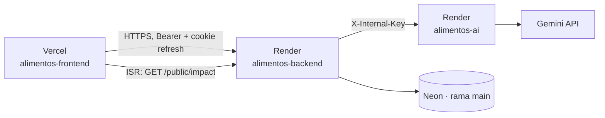

# Despliegue de AlimentaIQ

Guía para publicar, actualizar y presentar AlimentaIQ. Ningún valor real aparece aquí: las
variables se configuran en el panel de cada servicio y en el `.env` local (nunca en Git).

## 1. Entornos

| Pieza                | Dónde                | Notas                                                                 |
| -------------------- | -------------------- | --------------------------------------------------------------------- |
| `alimentos-frontend` | Vercel               | Next.js 16; SSG + ISR (`/impact`) + CSR; COOP/COEP siempre activos    |
| `alimentos-backend`  | Render (web service) | Fastify; health check `/health`; no ejecuta migraciones al arrancar   |
| `alimentos-ai`       | Render (web service) | Fastify sin base de datos; solo acepta llamadas con `X-Internal-Key`  |
| Base de datos        | Neon (PostgreSQL)    | Rama `main` = producción · `dev` = desarrollo · `bench` = seed grande |



## 2. Variables por servicio (sin valores)

### alimentos-backend (Render)

| Variable                                     | Obligatoria | Uso                                                                                                       |
| -------------------------------------------- | ----------- | --------------------------------------------------------------------------------------------------------- |
| `NODE_ENV`                                   | Sí          | `production`: errores 500 sin mensaje ni stack                                                            |
| `DATABASE_URL`                               | Sí          | Cadena **pooled** de la rama `main` de Neon                                                               |
| `DIRECT_URL`                                 | Sí          | Cadena **directa** de `main` (solo la usa `prisma migrate`)                                               |
| `CORS_ORIGINS`                               | Sí          | Orígenes exactos del frontend, separados por coma (`https://<app>.vercel.app`)                            |
| `JWT_ACCESS_SECRET`                          | Sí          | ≥ 32 caracteres aleatorios                                                                                |
| `ACCESS_TOKEN_TTL`, `REFRESH_TOKEN_TTL_DAYS` | No          | 15m y 7 días por defecto                                                                                  |
| `LOGIN_MAX_ATTEMPTS`, `LOGIN_WINDOW_MINUTES` | No          | 5 intentos en 15 minutos por defecto                                                                      |
| `APP_TIMEZONE`                               | No          | `America/Bogota` por defecto                                                                              |
| `TRUST_PROXY`                                | No          | `true` (defecto) o el número de saltos de proxy; ver §6                                                   |
| `BENCHMARK_MAX_SIZE`                         | No          | 30000 por defecto; **8000 en el plan gratis** (el modo hilo principal bloquea el servidor mientras corre) |
| `WORKER_POOL_SIZE`, `WORKER_TASK_TIMEOUT_MS` | No          | 2 workers y 30 s por defecto                                                                              |
| `AI_SERVICE_URL`, `AI_INTERNAL_KEY`          | No          | Sin ellas la IA queda "no configurada" y `AI_ASSISTED` se degrada a `BALANCED`                            |
| `AI_TIMEOUT_MS`                              | No          | 15 s por intento por defecto                                                                              |
| `PORT`                                       | —           | No se define: Render la inyecta                                                                           |

`SEED_*` y `SMOKE_*` **no** van en Render: solo se usan desde tu máquina (§5 y §7).

### alimentos-ai (Render)

| Variable                 | Obligatoria | Uso                                                                  |
| ------------------------ | ----------- | -------------------------------------------------------------------- |
| `NODE_ENV`               | Sí          | `production`                                                         |
| `AI_INTERNAL_KEY`        | Sí          | El **mismo** valor que en el backend                                 |
| `GEMINI_API_KEY`         | Sí          | Clave de Gemini (solo en este servicio; nunca en el frontend ni Git) |
| `GEMINI_MODEL`           | No          | Modelo a usar                                                        |
| `AI_UPSTREAM_TIMEOUT_MS` | No          | Timeout de la llamada a Gemini                                       |

### alimentos-frontend (Vercel)

| Variable              | Obligatoria | Uso                                                                                          |
| --------------------- | ----------- | -------------------------------------------------------------------------------------------- |
| `NEXT_PUBLIC_API_URL` | Sí          | Origen del backend en Render, sin barra final. Se incrusta en el build: cambiarla = redeploy |
| `API_URL_INTERNAL`    | No          | Solo servidor: origen del backend para el ISR de `/impact`                                   |

## 3. Orden de despliegue

1. **Migraciones** en la rama `main` de Neon (§4). Siempre antes que el código que las usa.
2. **alimentos-ai** (no depende de nadie). Esperar `GET /health` → 200.
3. **alimentos-backend**. Esperar `GET /health` y `GET /api/v1/health/ready` → 200.
4. **alimentos-frontend** (Vercel). El build genera `/es/impact` y `/en/impact` llamando al
   backend; si no responde, el build no falla y la página dice "Datos no disponibles" hasta la
   siguiente regeneración (máximo 1 hora).
5. `npm run smoke:prod` desde tu máquina (§7).

## 4. Migraciones

- Se crean solo con `npx prisma migrate dev --name <nombre>` contra la rama `dev`.
- Son **aditivas**: nunca se edita una migración commiteada ni se borra una tabla o columna en uso.
- Se aplican a producción **a mano, desde local y antes de desplegar**:

```bash
DATABASE_URL=<main> DIRECT_URL=<main> npx prisma migrate deploy
DATABASE_URL=<main> DIRECT_URL=<main> npx prisma migrate status   # "Database schema is up to date!"
```

Migración de la fase 6: `20261029180000_add_app_meta` (crea la tabla `app_meta`, clave/valor). No
toca datos existentes.

## 5. Seeds

| Comando                                              | Qué hace                                                                          | Idempotente                        |
| ---------------------------------------------------- | --------------------------------------------------------------------------------- | ---------------------------------- |
| `npx prisma db seed`                                 | Usuarios demo, catálogo, inventario por lotes, clientes y pedidos pendientes      | Sí (solo inserta lo que falta)     |
| `npm run seed:history`                               | ~60 pedidos **entregados** en 30 días (~80 % a tiempo) y algunas mermas recientes | Sí (no hace nada si hay DELIVERED) |
| `npm run seed:refresh-demo -- --confirm-host=<host>` | Mueve fechas al día de hoy (§8)                                                   | Sí para un mismo día               |
| `npm run seed:bench -- --confirm-host=<host>`        | Seed grande, **solo rama `bench`** (rechaza `NODE_ENV=production`)                | Sí                                 |

Todos imprimen solo el host de la base de datos y conteos; nunca la URL, usuarios ni contraseñas.
Para producción se ejecutan desde local con las cadenas de `main` en la línea de comandos:

```bash
DATABASE_URL=<main> DIRECT_URL=<main> npx prisma db seed
DATABASE_URL=<main> DIRECT_URL=<main> npm run seed:history
```

`seed:history` no crea stock nuevo: convierte los despachos históricos (`EXIT_DISPATCH`) que dejó el
seed en pedidos entregados (cada movimiento queda enlazado a su pedido) y registra 6 mermas
(`EXIT_WASTE`) de la última semana sobre los lotes que vencen primero.

## 6. TRUST_PROXY en Render

Fastify usa `X-Forwarded-For` para saber la IP real del cliente (límite de logins por email + IP,
límite de `/public/impact`). Con `TRUST_PROXY=true` confía en toda la cadena; lo más seguro es
fijar el número real de saltos:

1. Inicia sesión como ADMIN y llama `GET /api/v1/admin/network-info` (queda en la auditoría como
   `NETWORK_INFO_VIEWED`).
2. Mira `forwardedFor`: es la cadena que llega desde Render (`cliente, proxy1, …`). Cuenta las
   direcciones que **no** son la tuya: ese es el número de saltos `N`.
3. Pon `TRUST_PROXY=N` en Render y vuelve a llamar el endpoint: `ip` debe ser tu IP pública.
4. Si `ip` sale como una dirección interna de Render, `N` es corto: súbelo en uno.

## 7. Smoke de producción y calentamiento

```bash
SMOKE_BASE_URL=https://<backend>.onrender.com \
SMOKE_FRONTEND_ORIGIN=https://<app>.vercel.app \
SMOKE_ADMIN_EMAIL=... SMOKE_ADMIN_PASSWORD=... \
SMOKE_OPERATOR_EMAIL=... SMOKE_OPERATOR_PASSWORD=... \
npm run smoke:prod
```

(Sin `SMOKE_*_EMAIL/PASSWORD` usa las `SEED_*` del `.env`.) Comprueba health y ready, login de los
dos roles, `/me`, productos, alertas, pedidos, snapshot, una propuesta `BALANCED` y una
`AI_ASSISTED` (ambas se **descartan**: no se mueve stock), un reporte CSV, `/metrics/api`,
`/public/impact`, negativos por rol, el preflight CORS desde el frontend y logout. Imprime una tabla
PASS/WARN/FAIL con tiempos y sale con código ≠ 0 si algo falla. `AI_ASSISTED` degradado y
`/impact` sin entregas son **WARN**, no FAIL.

**Antes de presentar** (los servicios gratis duermen):

```bash
SMOKE_BASE_URL=... SMOKE_AI_URL=https://<ai>.onrender.com SMOKE_FRONTEND_ORIGIN=... \
npm run smoke:prod -- --warm
```

Hace ping a `/health` del backend y de la IA y a `/es` del frontend cada 5 s hasta recibir 200
(máximo 3 minutos). Después, `npm run smoke:prod` normal.

## 8. Rejuvenecer la demo (`seed:refresh-demo`)

Con los días el inventario demo "envejece" (lotes vencidos, pedidos atrasados). Antes de la
sustentación:

```bash
DATABASE_URL=<main> DIRECT_URL=<main> npm run seed:refresh-demo -- --confirm-host=<host de main>
```

- Guarda en `app_meta` la fecha ancla (`demo_anchor_date`) y mueve todo **los días transcurridos**
  desde ella: vencimiento y recepción de los lotes, `dueDate` y creación de los pedidos, historial
  de estados y movimientos. Mueve también los lotes ya vacíos y los pedidos entregados, para que
  `/impact` (rescatado, a tiempo) siga siendo coherente. Auditoría y propuestas no se tocan.
- Una sola transacción. El mismo día dos veces no cambia nada.
- **Primera vez**: pasa `--anchor=YYYY-MM-DD` con el día en que se sembró la base (sin él guarda
  hoy como ancla y no mueve nada).
- Exige `--confirm-host` igual al host de `DATABASE_URL` y solo imprime el host.

## 9. Rollback

| Qué falló                 | Cómo volver                                                                                                                                                 |
| ------------------------- | ----------------------------------------------------------------------------------------------------------------------------------------------------------- |
| Backend o IA en Render    | Render → _Deploys_ → **Rollback** al deploy anterior (o _Manual Deploy_ del commit previo)                                                                  |
| Frontend en Vercel        | Vercel → _Deployments_ → deploy anterior → **Promote to Production** (instantáneo)                                                                          |
| Migración                 | Las migraciones son aditivas: el código anterior sigue funcionando con la tabla nueva, así que **no se revierte** la migración; solo el código              |
| Datos (seed mal aplicado) | Neon → _Restore_ de la rama `main` a un punto anterior (point-in-time), o crear una rama desde ese punto y apuntar `DATABASE_URL` a ella mientras se revisa |
| Variable mal puesta       | Corregirla en el panel; en Render reinicia el servicio; en Vercel las `NEXT_PUBLIC_*` requieren redeploy                                                    |

Después de cualquier rollback: `npm run smoke:prod`.

## 10. Límites del plan gratis

- **Render free**: el servicio **duerme tras ~15 min sin tráfico** y tarda hasta ~1 minuto en
  despertar (de ahí `--warm`). CPU compartida y 512 MB de RAM: el benchmark en hilo principal con
  30.000 pedidos bloquea el servidor varios segundos → usar `BENCHMARK_MAX_SIZE=8000`. Las **horas
  de instancia del mes se comparten** entre los servicios gratis de la cuenta (backend + IA).
- **Neon free**: la base se suspende por inactividad y la primera consulta paga el arranque en frío
  (el `ready` del smoke lo absorbe); almacenamiento y horas de cómputo limitados por proyecto.
- **Vercel hobby**: el ISR de `/impact` cuenta como invocaciones de función, como mucho una por
  hora y por idioma.
- Las métricas (`/metrics/*`) viven en memoria: se reinician con cada deploy o cuando Render duerme
  el servicio.
